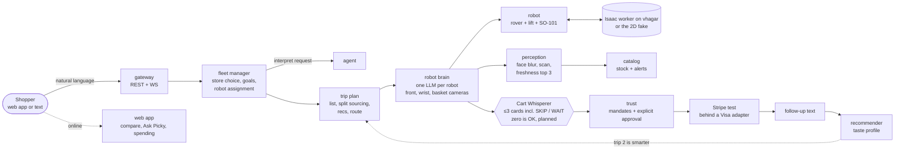

# Picky

**A fleet of personal AI shopping robots for physical stores.** Built at DubHacks 2026 (UW) for the Visa
"Reimagine Shopping" track.

You save your preferences, lists, budget and favorites once. Then you say what you want in plain language. A fleet
manager picks the store (or stores) that cover your list best for the money and hands the work to robots. Each robot is
a small rover with a vertical lift, an SO-101 arm and a basket, and it runs its own LLM "brain" that sees through its
cameras. The robot drives an efficient route, picks every item, detours past things you'll probably like (it asks
first), stays inside your budget, and checks out only after you approve. Store staff use the same system for shelf
scans, stock levels and restocking.

Online, the same assistant tracks what you buy and spend, flags what's probably running low, compares prices across
retailers (including open-box and warehouse) with 13 weeks of history, tells you *Good price*, *Wait* or *Skip it*, and
answers money questions (Ask Picky). The robots are its in-store body: one memory, online and in the aisle.

*Everyone else built a shopping chatbot. Picky carries your shopping memory into the store, drives the route itself,
and is willing to tell you "don't buy that."*

> **The story.** Maya types *"tacos for 6, under $40, one vegetarian"*. Picky expands that into tortillas, beef,
> black beans, cheese, salsa, avocados and more, with quantities for 6. Cilantro is out of stock, so it goes to the
> online order. Pico, the robot at The Ave store, plans a route with a few "you'd like this" detours, shows the
> 3 freshest avocados, and asks *"Ghost Pepper hot sauce? You rated Classic Red 5★"*. Checkout runs through a
> deterministic mandate engine and Maya's explicit approval, then a Stripe test payment behind a Visa adapter. After
> the trip Picky texts *"How was the salsa?"*, she says it was too mild, and trip 2 picks a spicier one.

> **The wireless store.** At the T-Mobile-style store Maya asks for *"case and screen protector for my new Pixel 9,
> under $90"*. Picky lists the Clear Case ($29.99) and the glass ($23.99, 20% off with the case). It says **skip** the
> charger (she bought a 20W USB-C one in March) and **wait** on the phone (4 installments left on her Pixel 7; a
> $200-off promo is expected Nov 27, and it'll text her). For running earbuds it says wait for Friday's $20-off sale,
> and finds nothing worth a detour.

Which store is the live demo store is still an open team decision.

## Hackathon and tracks

DubHacks 2026, University of Washington, Oct 17–18 2026. Repo: `github.com/adsdemaybe/picky` (private now; it goes
public before submission).

| Track | How Picky addresses it |
|---|---|
| **Visa "Reimagine Shopping"** (main track). Rubric: Innovation 25%, User Experience 25%, Technical Execution 20%, Commerce Impact 15%, Trust & Responsibility 15% (weights are from the team brief) | A shopper-owned agent that works across stores. Routes that cover the whole list plus interest-weighted detours. In-store and online items in one checkout. A merchant dashboard built from robot scans. Payments gated by deterministic mandates and explicit approval. Journey stages covered: discovery (detours, deals), decision (Find & compare, verdicts), personalization (one memory), checkout + payments (mandates, approval), post-purchase (follow-up); loyalty (receipt points) is P2, not built. |
| **T-Mobile "Cart Whisperer: Checkout suggestions that actually help"** (entered) | Direction **Cart Whisperer** ([below](#cart-whisperer-t-mobile-track)) + the brief's "bring the one that says wait". Demo store: a T-Mobile-style wireless store (phones, cases, screen protectors, chargers, earbuds, watch, home-internet gateway; fictional data). ≤3 suggestions per moment, zero is valid, explicit SKIP and WAIT cards, a visible why on each. ⚠️ Rubric from the team's copy of the brief: Customer value 30%, Use of signals 25%, Explainability & trust 20%, Feasibility & demo 25%. |
| **Photon 2.0** messaging agent | The `messaging` arm: text your request before the trip, answer the robot's questions and approvals by text, and get a follow-up after the trip that updates your taste profile. The track requires the agent to be live on at least one Photon channel; it isn't live yet. |
| **SideShift "Best Startup Idea"** | Free for shoppers. Grocers pay SaaS for shelf intelligence (out-of-stocks, mispricings, heatmaps) and personalized basket lift. No pay-to-play placement. Wedge: the online assistant ships first as software and builds the memory; stores pay robot-as-a-service + shelf intelligence + a share of measured basket lift; the honest "says wait" recommender is the moat. |

Sponsor-track cap unconfirmed (prior year: two sponsored + the title track); what we enter is an open team decision.
If capped, the team plan's default priority is Visa → T-Mobile → Photon → SideShift.

## How it works



1. **Request.** You type in the web app chat or its Robot order page (or text the Photon line); it goes to
   `POST /api/requests`.
2. **Fleet manager** (`arms/fleet`). `agent.interpret_request` turns the text into a draft (shop, fetch, shelf scan
   or return to dock, plus list, budget and hints). The fleet picks stores by stock coverage and price, may split the
   list, and sends anything out of stock everywhere online. Each goal goes to a robot in that store by a
   deterministic score (idle, battery, distance), and is reassigned if the robot fails.
3. **Trip plan.** List with quantities and substitutions, in-store vs online sourcing, optional recommended stops
   (each with "why you'd like this"), and a route: A* on an occupancy grid plus OR-Tools orienteering, where list
   items are mandatory and recommendations are optional with a skip penalty equal to your predicted interest. If no
   recommendation beats its walking cost, there are zero detours ("Nothing worth a stop today"). Two fulfillment
   modes: **shop with the robot** (meet it in the store, approve on your phone) or **robot shops, I pick up** ("grab
   my usual"; every extra still asks by web or text, and the trip ends at the pickup counter).
4. **Robot brain** (`arms/agent`). A tool loop per robot: locate, plan route, navigate, look (camera to vision), scan,
   pick, place in basket, ask the user, update progress, finish. Each step is a `brain.step` event, so the web app
   shows what every robot is thinking. Without an API key a scripted brain runs the same tool sequence.
5. **Robot in sim.** Each store runs in the Isaac worker or the 2D fake; picking is a scripted "magic grasp" for now.
   Scans and picks update stock and raise low/out alerts.
6. **Cart Whisperer** gives at most 3 cards per moment (when the list is ready, as the cart changes or the robot picks
   something, and before you pay), SKIP and WAIT included; zero is a valid answer (planned; the planning-phase cards
   already show in the web app on demo data).
7. **Pay.** Mandate engine (deterministic code) → explicit approval bound to the cart hash → Stripe test checkout
   behind a Visa Intelligent Commerce adapter → signed receipt.
8. **After.** A follow-up text ("how was the salsa?") updates the taste profile, so trip 2 is visibly smarter.

The full flow, events and state machines are in [`CLAUDE.md` §2](CLAUDE.md#2-the-pipeline),
[`docs/architecture.md`](docs/architecture.md) and [`contracts/OVERVIEW.md`](contracts/OVERVIEW.md).

### Cart Whisperer (T-Mobile track)

> **Status: designed, not implemented in the backend yet.** It needs a contracts change after v0.2 merges (proposed
> v0.3: `ShopperContext`, `Suggestion` with `skip` / `wait` kinds and reason codes, `RecommenderService.suggest` /
> `respond`, a `suggestions.updated` event that may be empty, `GET /api/trips/{id}/suggestions` +
> `POST /api/trips/{id}/suggestions/{suggestion_id}`, and the wireless-store fields: owned items, devices,
> `compatible_with`, promo calendar). Owner: recommender. The web app already shows the planning-phase SKIP / WAIT
> cards and the zero case on demo data.

**Use everything Picky knows about the shopper, then make a few suggestions that actually help:** when the list is
ready, whenever the cart changes or the robot picks something during a trip, plus a final "before you pay" pass. At
most 3 per moment, SKIP and WAIT included; zero is valid ("Nothing worth adding today").

- **Context, assembled on the server, in three signal families.** Commerce: the cart now, stock, prices, deals,
  near-expiry markdowns, the promo calendar and price history. Customer: profile (likes, dislikes, dietary needs and
  allergens, brands, ratings, taste vector), purchase history and cadence (probably running low, or just bought),
  intent (the request, occasion, party size), money (budget, headroom, mandate caps, "ask me above $X"), and for the
  wireless store owned items, device age, installments left and household lines. Physical: where the robot is, the
  slot ahead, what it just picked up, detour cost. Plus what you said in chat ("no cilantro") and suggestions you
  already declined.
- **Kinds:** *complete* (tacos for 6 with no tortillas), *replenish* (you're probably out of milk), *swap/save* (same
  need, cheaper, or back under budget), *quantity fix* (1 avocado for 6 people), *deal match* (a markdown that fits your
  taste), *remove/warn* (an allergen conflict, shipping waste, over budget), *skip* (you own it, bought it recently, or
  it doesn't fit your phone) and *wait* (a known sale soon, over budget, the upgrade is too early; Picky texts you a
  reminder).
- **Pipeline:** deterministic candidates → hard gates in code (in stock, compatibility, allergens and dislikes,
  mandate and budget headroom, not declined before, max detour) → deterministic score with reason codes; below a
  threshold nothing is shown → Claude only phrases the "why" from the reason codes (no rerank), validated against the
  signals → top 0–3, each with an action, price change, savings or avoided spend, and detour. The fake uses
  deterministic scores and templated reasons, so the demo runs with no key.
- **T-Mobile rubric (⚠️ team's copy):** customer value 30% (≤3, zero is valid, SKIP / WAIT, $ saved or avoided) · use
  of signals 25% (commerce + customer + physical) · explainability & trust 20% (reason codes, "why am I seeing this",
  not sponsored, mandate never bypassed) · feasibility & demo 25% (deterministic fakes, web app on demo data, robot in
  sim).
- **UX and trust:** one-tap accept or decline on the live trip card and the checkout panel, plus a text version
  ("Before you check out: ..."). An accept goes through `add_to_cart` → mandate engine → approval if needed, and a
  mid-trip add re-plans the route. A decline feeds the profile. Every suggestion shows why you're seeing it, nothing is
  paid placement (sponsored items would be labeled), and "ask me above $X" is never bypassed. Raw context stays on the
  server; only the derived signals are shown.
- **Metrics:** accepted-suggestion rate, dollars saved, avoided spend (SKIP / WAIT, an estimate), dollars added,
  basket completeness, zero-suggestion rate.
- **Demo beat (trip 1, amounts from the current fixtures):** mid-trip, "One pack of Corn Tortillas 30 ct covers 6
  people at 3 each, pick 1 not 2: −$2.79" (accept) · "2 lb ground beef but no seasoning: Taco Seasoning Mix $1.49, two
  slots over (+0 m)" (accept) · "Swap 1 lb beef for Soy Chorizo, covers your vegetarian guest, save $1.00" (declined).
  Before you pay: "Cilantro is your only online item, $1.29 + $2.99 shipping. Drop it: −$4.28" (accept). Panel: "saved
  $7.07 · added $1.49 · 3 of 4 accepted". Trip 2 hides the declined swap.
- **Demo beat (wireless store):** SKIP the charger (−$24.99), WAIT on the phone (4 installments left, $200 off
  expected Nov 27), total $73.97 under a $90 budget; then running earbuds get a WAIT (Fri Oct 23, save $20) and
  "Nothing worth a stop today". Full scripts:
  [`docs/cart-whisperer.md` §11](docs/cart-whisperer.md#11-demo-beats) and [`docs/demo-script.md`](docs/demo-script.md).

## The web app

The only UI: no native app, and no screen on the robot. A teammate builds it on `arm/frontend` (draft PR #12; this
section matches its commit `6fc1c41`, 18:13 PT): Next.js 16 + React 19 + Tailwind 4 + shadcn/ui (radix) + Lucide +
motion + zustand. Today it runs on demo data generated from `data/*.yaml` by `scripts/gen-data.mjs` (seeded purchase
history is flagged synthetic), plus a client-side trip replay that emits `contracts.events` names. It is **not wired
to the gateway yet** (only the Live page's gateway camera source talks to it); a `GatewaySource` is next.

Nav: Home, Find, Spending, Robot, Live, Ask; Permissions ("Rules and privacy") is in the account menu.

| Screen | What it does |
|---|---|
| **Home** (`/`) | Month spend vs budget, "probably running low" (from purchase cadence), recent trips, a live-order banner |
| **Ask Picky** (`/ask`, plus the header ask bar) | Claude over deterministic tools (spending, budget, price check, search, savings, "can I afford"); answers offline from the same tools with no key |
| **Find & compare** (`/find`) | Seven fictional stores and retailers incl. open-box, warehouse and delivery; 13-week price history; Good price / Wait / Typical / High / Skip it; cheaper swaps |
| **Spending** (`/purchases`) | Weekly spend by category, trip ledger, ratings |
| **Robot order** (`/order`) | `store_ave` and `store_tmobile`; in-store / online badges; "Picky's advice" cards (**Skip it** / **Worth waiting**); detours with reason + "Not sponsored", or "Nothing worth a stop today"; both fulfillment modes ("Shop with me" / "Shop for me, I'll pick up"); mandate preview |
| **Live trip** (`/trip`) | Map with dashed detours, stop timeline, cart + basket check, approvals (incl. top-3 avocado pick and a cart-hash checkout), test-mode receipt, camera panel (same source as Live) |
| **Live** (`/live`) | Camera source, always labeled: **Simulated** (in-browser trip, no backend), **Robot gateway** (`WS /ws/frames`, only `blurred=true` frames drawn, plus `GET /health`), **Direct stream** (an MJPEG / MP4 URL per camera; a recorded backup video goes here) |
| **Permissions** (`/permissions`) | Mandate (plus a separate tech cap), taste profile with delete, approval history |

**Still to build:** the store-staff views (stock, alerts, restock, cameras, merchant dashboard) and the fleet view;
who builds them is open. Offers from the fictional retailers, price history, spending and "running low" are web-app
demo data until catalog / recommender APIs exist (contracts v0.3). The web app's client-side A* (`src/lib/routing.ts`)
is a stand-in until it renders the gateway's `route.planned`, and `store_tmobile` is a TS fixture until
`data/planograms/store_tmobile.yaml` lands (the planogram stays the source of truth).

**Run it:**

```bash
cd arms/frontend
npx pnpm@10.18.3 install     # or `pnpm i` with pnpm on PATH
npx pnpm@10.18.3 dev         # or `pnpm dev`; regenerates demo data first → http://localhost:3000
```

Keys go in `arms/frontend/.env.local` (copy its `.env.example`): `ANTHROPIC_API_KEY` (Ask Picky; blank = offline
answers), `NEXT_PUBLIC_GATEWAY_URL` (presets the Live page's gateway source), `NEXT_PUBLIC_STREAM_URL` (presets a
direct stream). How each screen maps onto the gateway, the event and vocabulary gaps, and the missing endpoints:
[`docs/frontend-backend-map.md`](docs/frontend-backend-map.md). The app's own plan is `arms/frontend/APP_PLAN.md`, and
the team's master plan is `docs/team-plan.md`; both live on `arm/frontend` until PR #12 merges.

## The robot

| Part | Spec |
|---|---|
| Base | Small rover, radius 0.3 m, about 0.8 m/s, with a battery model and a dock |
| Lift | Vertical lift, 0.2–1.2 m |
| Arm | SO-101 arm on the lift, reach about 0.35 m, reaches shelf items at 0.1–1.5 m |
| Basket | On the back; unloaded at checkout |
| Cameras | `<robot_id>.front` (pan-tilt mast), `.wrist` (gripper), `.basket`; stores also have ceiling cameras |

The fleet (`data/fixtures/robots.yaml`): **Pico** (`rover-ave-1`) and **Rhea** (`rover-ave-2`) in `store_ave`
("Picky Market - The Ave", 14 × 22 m), and **Hazel** (`rover-hill-1`) in `store_hill` ("Picky Express - Capitol
Hill", 9 × 14 m). There is also a mock online store. The T-Mobile-style store (`store_tmobile`, 10 × 8 m) exists only
in the web app's demo data today; its planogram and a robot join `data/` after v0.2. Everything runs in sim today. A
physical SO-101 on a real rover and VLA fine-tuning (LeRobot / LeIsaac) for real grasping come later; the robot model
in `contracts.common` is kept compatible with that.

## Quick start

Needs [uv](https://docs.astral.sh/uv/) (Python 3.12) and `make`. Docker only for the Postgres-backed catalog.

```bash
gh repo clone adsdemaybe/picky && cd picky
make setup               # uv sync --locked (base deps + dev tools)
cp .env.example .env     # every key is optional; blank = fakes
make check               # lint, format check, rules check, tests (what CI runs)
make demo                # headless trip 1 → follow-up → trip 2, all arms fake; ends with "DEMO OK" + "LOOP OK"
make dev                 # gateway on http://localhost:8000
make web                 # the web app on :3000 (needs pnpm on PATH; or the npx commands in "The web app")
```

`make demo` runs the shop goals through the planner → VLA → verifier loop (contracts 0.2.1) and injects one bad grasp
(`drop_on_first_grasp`): the summary shows the verifier catching it and the retry succeeding.
`make demo ARGS="--exec-mode direct"` is the v0.2 brain path (`PICKY_EXEC_MODE=direct` is the kill switch).

Then open **http://localhost:8000/debug** (a built-in test page: fleet, the step plan + VLA progress, the verifier's
verdicts with evidence, cameras, stock alerts, a request box and the trip view; `/` redirects there; `PICKY_DEV=1 make
dev` adds the presenter's fault controls) and **http://localhost:8000/docs** (interactive API docs). `make help` lists every
target.

**Browser test (optional).** `uv sync --group e2e && uv run --group e2e playwright install chromium`, then
`PICKY_E2E=1 uv run --group e2e pytest tests/e2e -s` drives `/debug` in headless Chromium and saves screenshots to
`tests/e2e/artifacts/`.

**Real arms.** Every arm runs its fake unless it's listed in `PICKY_REAL_ARMS`:

```bash
uv sync --extra routing --extra trust          # heavy deps per arm (`uv sync --all-extras` for everything)
PICKY_REAL_ARMS=routing,trust make demo         # a real arm that can't start falls back to its fake; /health says why
make db-up && make seed                         # local Postgres + pgvector, seeded from data/ (catalog extra)
```

Keys go in `.env` (see [`.env.example`](.env.example)): `GEMINI_API_KEY` switches the agent and robot brains to
Gemini (needs `uv sync --extra agent`; `PICKY_LLM_PROVIDER=anthropic` + `ANTHROPIC_API_KEY` for Claude; blank =
deterministic fakes); `PERCEPTRON_API_KEY` switches the loop verifier's vision to Perceptron Mk1.5 with
`PICKY_REAL_ARMS=perception` (needs `uv sync --extra perception`; blank = the ground-truth fake verifier); also
`STRIPE_SECRET_KEY` (test mode), `PHOTON_*`, `DEEPGRAM_API_KEY`. `PICKY_REAL_ARMS=evidence` (no key) gives the
verifier panel real camera thumbnails instead of the fakes' flat frames. The web app reads its own
`arms/frontend/.env.local`.
`make setup` removes extras, so re-run `uv sync --extra <arm>` after it.

## API at a glance (for the web app)

The gateway is the only backend the web app talks to. Full reference: [`contracts/api.md`](contracts/api.md), which
includes a screen → endpoint table. Live and interactive: `/docs`. All money is integer cents.

| Group | Endpoints |
|---|---|
| Requests (chat) | `POST /api/requests` (reply to a question with `in_reply_to`), `GET /api/requests[/{id}]` |
| Fleet + robots | `GET /api/fleet/robots[/{id}]`, `.../brain`, `.../steps`; `POST .../messages`, `.../goals`, `.../stop` |
| Goals | `GET/POST /api/goals`, `GET /api/goals/{id}[/steps]`, `POST /api/goals/{id}/cancel` |
| Trips | `GET/POST /api/trips`, `GET /api/trips/{id}`, `POST .../messages`, `.../checkout`, `.../followup` (`.../login` only for manual trips) |
| Approvals | `GET /api/approvals`, `POST /api/approvals/{id}` (a checkout approval is bound to `cart_hash`) |
| Catalog | `GET /api/stores`, `.../planogram`, `.../grid`, `.../deals`, `.../near-expiry`, `/api/products/search`, `/api/categories` |
| Stock (staff) | `GET /api/stores/{id}/stock`, `.../stock/alerts`, `.../stock/history`; `POST .../stock/restock`, `.../stock/adjust` |
| Cameras | `GET /api/cameras`, `.../{id}/snapshot.jpg`, `.../{id}/stream.mjpg` (works as ``), `POST .../{id}/observe`; every frame is face-blurred |
| Profiles + trust | `GET/PUT /api/users/{id}/profile`, `.../mandate`; `POST .../feedback`; `GET /api/trust/ledger` |
| Merchant + system | `GET /api/merchant/{store_id}/dashboard`, `GET /api/sim/status`, `GET /health` |
| WebSockets | `/ws` (events, filter by `trip_id` / `store_id` / `robot_id` / `user_id` / `request_id`), `/ws/frames` (one robot's live cameras), `/ws/cameras` (camera grid), `/ws/sim` (sim worker only) |

Tips: read the `X-Event-Seq` header from a REST fetch, then open `/ws?...&after_seq=<n>` and dedupe by `seq`. The
Next.js dev server runs on another origin, so prefix the API base or proxy `/api` and `/ws`. Use at most 2–3 MJPEG
streams per page and snapshot polling for grids. `make gen-types` exports JSON schemas from the contracts and
generates the TypeScript types (never hand-write them); the web app on `arm/frontend` still needs a `gen-types`
script in its `package.json` (it hand-keeps a small event subset today).

Web-app hand-offs (details in [`docs/frontend-backend-map.md`](docs/frontend-backend-map.md)):

- The web app's base-URL variable is `NEXT_PUBLIC_GATEWAY_URL`. `contracts/api.md` says `NEXT_PUBLIC_API_BASE`; it gets
  aligned in the next contracts PR.
- The web app's gateway camera source (`src/lib/feed.ts`) opens `/ws/frames` with an optional `?trip_id=` and reads
  legacy `frame` events with `frame.camera` = `head` / `wrist` / `basket` / `overview`. v0.2 `/ws/frames` needs
  `?trip_id=` or `?robot_id=` and sends `camera.frame` (`camera_id` = `<robot_id>.front` / `.wrist` / `.basket`;
  `head` = `front`, no `overview`). The legacy `frame` (front camera only) needs `&legacy=1`.
- Manual (walk-up) trips start from the web app ("I'm at the robot") →
  `POST /api/trips/{id}/login {user_id, robot_id}`. There's no screen on the robot, so the web app's 6-digit login
  code has nothing to be typed on; it becomes that button.
- Planned (v0.3) for the online screens: offers across retailers, price history + verdicts, purchases / spending /
  running low, Cart Whisperer suggestions.

## Sim

- **2D fake (always available).** The robot arm's built-in top-down sim drives every robot in every store and draws
  synthetic camera frames with Pillow. `make demo` and the CI use it.
- **Isaac Sim worker on the GPU host "vhagar".** One headless process hosts several stores and rovers built from the
  planogram, connects outbound to the gateway's `/ws/sim` (`PICKY_SIM_TOKEN`, multiplexed by `robot_id`) and streams
  cameras on demand. A store runs on Isaac only when the worker hosts it with a matching data hash; if Isaac drops,
  robots continue on the 2D fake from their last state. Deployment on vhagar is in progress (status in the sim arm's
  README; the worker protocol is verified with its Pillow backend). `make sim` (GPU host only); see [`arms/sim/README.md`](arms/sim/README.md) and the
  deployment guide [`arms/sim/DEPLOY.md`](arms/sim/DEPLOY.md).

## Repo layout

```
contracts/   locked interfaces: pydantic models, service Protocols, events, LLM tool schemas, DB schema, api.md
utils/       shared helpers: config, logging, db, LLM client, money, geometry, ids, event bus, data loaders
arms/<arm>/  one folder per feature arm: README.md, __init__.py (create / create_fake), service.py, fake.py, tests/
data/        source of truth: products, planograms per store, online store, categories, fixtures (users, robots)
docs/        research.md, architecture.md, demo-script.md, cart-whisperer.md, frontend-backend-map.md, pitch/ (slides,
             Devpost text); team-plan.md (team master plan) is on arm/frontend until #12 merges
scripts/     repo tooling (sync_agent_rules.py)
```

Arms import only `contracts` and `utils`, never each other. The gateway is the only place they're wired together, and
every arm ships a deterministic fake so the pipeline always runs.

| Arm | Owns | Draft PR |
|---|---|---|
| foundation | Contracts, utils, tooling, arm scaffolds | #1 |
| fleet | NL request → store choice → goals → robot assignment, monitoring, reassignment | to be opened |
| agent | Request understanding, shopper chat, and the per-robot managing LLM (`brain.step`) | #8 |
| catalog | Planogram, mock ERP, multi-store search, deals, near-expiry, categories, stock management | #3 |
| perception | Cameras API, face blurring, shelf scans, freshness top 3, basket check | #4 |
| sim | Isaac Sim worker: multi-store, multi-rover scenes, cameras | #5 |
| robot | Multi-robot `RobotService`: waypoints, magic grasp, basket, battery; Isaac or 2D fake per store | #6 |
| routing | Occupancy grid, A*, OR-Tools orienteering with optional stops | #7 |
| recommender | Profiles, explainable recs, feedback loop; Cart Whisperer incl. SKIP / WAIT (planned) | #9 |
| trust | Mandate engine, approvals, Stripe test checkout behind a Visa adapter, transparency log | #10 |
| messaging | Photon 2.0 agent: request by text, approvals, follow-ups | #11 |
| frontend | THE web app (Next.js): Home, Ask Picky, Find & compare, Spending, Robot order, Live trip, Live, Permissions on demo data; staff + fleet views to build | #12 |
| gateway | FastAPI composition root: REST + WS, trip state machine, event bus, sim link | #13 |

Issues: #2 (Hour-0 setup), #14 (demo safety and submission).

## Status

Honest snapshot. Each arm's README has the detailed checklist.

| | |
|---|---|
| **Works today** | Backend v0.1 on :8000: the full trip pipeline end to end on fakes with no API keys (`make demo` runs trip 1 → follow-up → a smarter trip 2), gateway REST + WebSockets, the trip state machine, approvals bound to the cart hash, and the `/debug` page. The web app on demo data with a client-side trip replay (`arm/frontend`, PR #12; not wired to the gateway). |
| **Being built now (v0.2)** | Fleet manager across 2 stores and 3 rovers. Per-robot brains (Claude tool loop, scripted fallback, `brain.step`). Multi-robot, multi-store sim. Cameras, stock management and categories APIs. |
| **Next** | Wire the web app to the gateway (GatewaySource); store-staff + fleet views. Cart Whisperer incl. SKIP / WAIT in both store types (designed; contracts v0.3, then implementation). The T-Mobile-style store, promo calendar and price history in `data/`. Real LLM paths tested with keys. Photon live on iMessage. Isaac deployment on vhagar. Postgres-backed catalog. |
| **Later** | A physical SO-101 on a real rover, and VLA fine-tuning for real grasping. |

## Trust and privacy

- Faces are blurred on every camera frame before it's stored, streamed or sent to an LLM.
- Every recommendation and suggestion carries its reason and signals. No hidden paid placement; sponsored items are
  labeled.
- **The LLM proposes; code decides.** Mandates (spending cap, allowed categories, "ask me above $X") are deterministic
  code, and nothing is paid without an explicit approval bound to the cart hash.
- Test and sandbox payments only, tokenized credentials only, no stored card numbers.
- Picky remembers only what you can see and delete (the web app's Permissions page).
- Synthetic data only: fictional stores, retailers, prices, devices and users.
- No login in the demo; the app opens as a fictional user (Maya; the account menu says "Demo account (fictional
  data)"). The browser never queries the DB, only the gateway.
- We don't claim a privacy mode: model calls go to the Gemini API (Claude if configured), and faces are blurred before any
  frame leaves the pipeline.

## Contributing

The full guide is [`CLAUDE.md` §5](CLAUDE.md#5-how-to-contribute). In short:

- `main` is always demo-able and nobody pushes to it. Every change lands through a PR.
- A new arm is built on `arm/<arm>` and merged by its draft PR. Later changes use `feat/<arm>-<slug>`,
  `fix/<arm>-<slug>`, `contracts/<slug>`, `utils/<slug>` or `chore/<slug>`.
- Stay inside your arm folder. Contract changes go in their own `contracts/` PR.
- Pull constantly: `git pull && git fetch && git merge origin/main`.
- Before a PR: `make fmt`, `make check`, and `PICKY_REAL_ARMS=<arm> make demo`.
- After editing `CLAUDE.md` or an arm README, run `make rules`. It regenerates the Cursor rules in `.cursor/rules/`.

## Timeline (PT)

| When | Milestone |
|---|---|
| Sat Oct 17, ~12:30 PM | Hacking starts |
| Sat ~9–10 PM | Thin end-to-end loop on `main` |
| Sun Oct 18, ~5:30 AM | Feature freeze (fix PRs only), record the backup video |
| Sun 8:00 AM | Code freeze, rehearse 3 times |
| Sun 10:00 AM | Submit (hard deadline 10:30 AM) |
| Sun 11:30 AM–2:00 PM | Judging |

## Links

[`CLAUDE.md`](CLAUDE.md) (rules for humans and AI) · [`contracts/api.md`](contracts/api.md) ·
[`contracts/OVERVIEW.md`](contracts/OVERVIEW.md) · [`docs/demo-script.md`](docs/demo-script.md) (3-minute demo,
fallback ladder) · [`docs/architecture.md`](docs/architecture.md) · [`docs/research.md`](docs/research.md) (stack,
unverified claims) · [`data/README.md`](data/README.md) (stores and the taco-night scenario) ·
[`docs/cart-whisperer.md`](docs/cart-whisperer.md) (T-Mobile track design) ·
[`docs/frontend-backend-map.md`](docs/frontend-backend-map.md) (web app ↔ gateway) · on `arm/frontend` until PR #12
merges: `docs/team-plan.md` (team master plan) and `arms/frontend/APP_PLAN.md` (web app plan)
