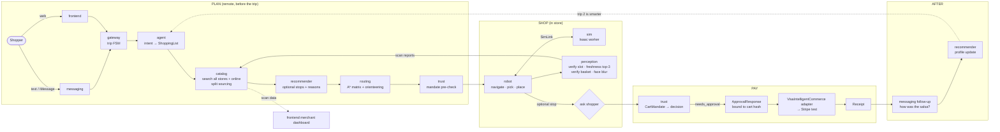
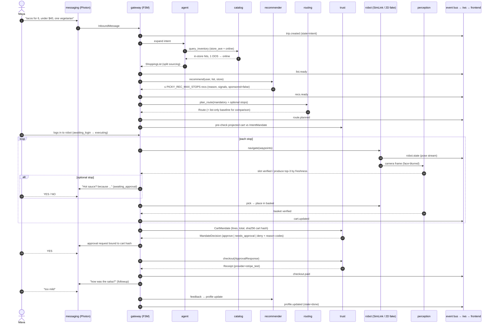
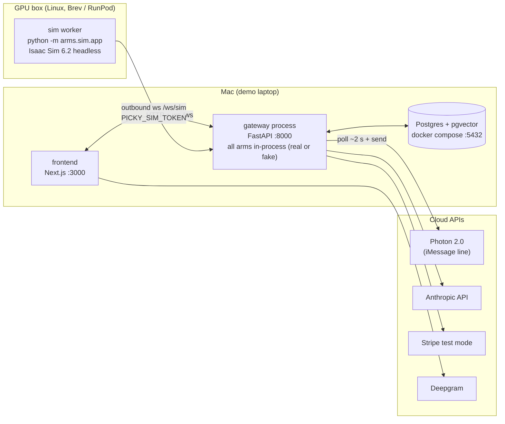
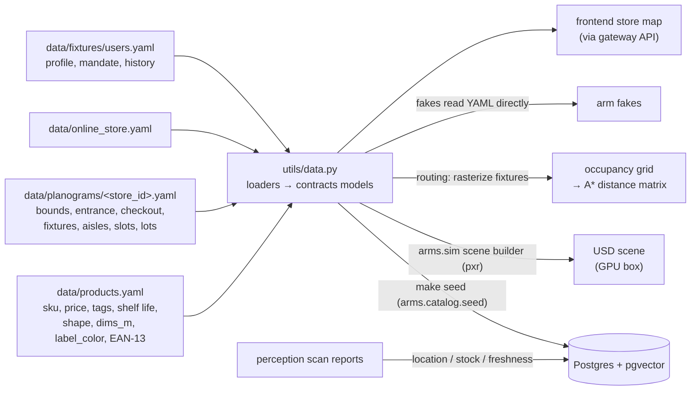

# Picky architecture

How the pieces fit at runtime. The rules live in [`CLAUDE.md`](../CLAUDE.md) (§2 pipeline, §4 layout rules); the
interfaces live in [`contracts/`](../contracts). This page is the map. Event names below are illustrative; the exact
set is the discriminated union in `contracts/events.py`.

## 1. The pipeline

Every arm is one stage of one flow. `arms/gateway` runs it as a trip state machine and is the only place arms are
wired together.



### Trip state machine (`contracts` `TripState`)

```
intent → list_ready → recs_ready → route_planned → awaiting_login → executing ⇄ awaiting_approval
       → checkout → paid → followup → done          (any state → failed)
```

### One trip, across arms and events

Each arrow into **Bus** is a `contracts.events` event (envelope: `trip_id`, `ts`, `seq`, `type`) that the gateway
publishes on its in-process bus and fans out to every websocket client (`/ws`).



## 2. Process topology



- **One backend process, one worker.** The event bus is in-process; never run uvicorn with `--workers > 1`.
  Blocking work (OR-Tools, CV, sync DB) goes through `asyncio.to_thread`.
- **The sim worker dials out** to `PICKY_GATEWAY_URL` + `/ws/sim` with `PICKY_SIM_TOKEN`, so the GPU box needs no
  inbound ports. It exchanges `contracts/sim.py` messages: commands with `cmd_id` → results, robot state, camera frames
  (JPEG base64), ground-truth instance info. The gateway exposes this connection to the robot arm as a `SimLink`.
- **Photon is polled**, not webhooked: no public URL needed for the Mac. The user texts the shared line first.
- If the GPU box is down, nothing waits on it: the robot fake (2D kinematic sim) drives the same Protocol.

## 3. Real vs fake

Every arm exports `create(services)` (real, `service.py`) and `create_fake(services)` (deterministic, `fake.py`,
base deps only). The gateway is the composition root:

1. Build an empty `contracts.services.Services` container.
2. For each arm: `real = arm in PICKY_REAL_ARMS` → `services.<field> = arm.create(services)` else
   `arm.create_fake(services)`. Default (blank) = all fakes, so `make demo` runs with no keys and no GPU.
3. Add the gateway-owned `ApprovalBroker`, `EventPublisher` and (robot only) `SimLink`.

Factories never call other services while constructing (only at call time), so construction order doesn't matter.
Arms never import each other; they reach each other only through `services.<field>`.

```bash
make demo                                    # all fakes
PICKY_REAL_ARMS=routing make demo            # real routing, everything else fake
PICKY_REAL_ARMS=catalog,routing,trust make demo
```

Switching back to a fake is an env change only, never a code change. That is the per-arm fallback during the demo.

## 4. Data flow

The planogram is the single source of truth. Nothing generated is hand-edited: fix the data or the generator.



Stores: `store_ave` (main demo store, ~14 m × 22 m, 5–6 aisles + produce + checkout), `store_hill` (smaller second
store), `online` (mock online store, no planogram). Coordinates: meters, world frame with x right, y up, origin at the
store's bottom-left, theta CCW from +x. Money: integer cents everywhere.
