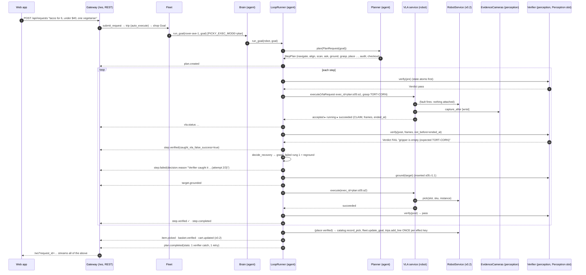

# Gateway API additions for the planner → VLA → verifier loop (contracts v0.3 draft)

Additive on `contracts/api.md` (v0.2). Nothing in v0.2 changes. Every new route is served by `arms/gateway` and backed
by a `ServicesV03` field (`runner`, `planner`, `vla`, `verifier`, `evidence`, `truth`, `faults`). Errors follow the
v0.2 rules: `KeyError` → 404, rule violation (`ValueError`) → 409, bad body → 422. All money is integer cents. Frames
are never inlined: payloads carry `FrameRef` (`url` = `/api/evidence/{frame_id}.jpg`, always face-blurred).

**Kill switch.** `PICKY_EXEC_MODE` defaults to `direct`, which is the exact v0.2 brain path. `exec_mode(services,
settings.PICKY_EXEC_MODE)` returns `plan` or `tools` only when planner, runner, vla and verifier are all wired.

| mode | who drives | what changes |
|---|---|---|
| `direct` | v0.2 brain tools call `RobotService` | nothing (no new events) |
| `plan` | `RobotBrainService.run_goal` → `LoopRunner.run_goal` (planner → StepPlan → loop) | full v0.3 events; effects committed by the runner after verification |
| `tools` | v0.2 LLM tool loop; motion tools → `LoopRunner.run_tool_step` | one live plan per goal; v0.2 side effects applied by the executor after a VERIFIED outcome (see tools.md) |

**Version.** Ship the T0 loop as `CONTRACTS_VERSION = "0.2.1"`. `versions_compatible` compares major.minor, so
`0.3.0` would refuse every v0.2 Isaac worker. Bump to `0.3.0` only with `RunSkillCmd` / `SkillProgress` (T1 on
vhagar) and a worker rebuild.

## REST

P0 = needed for tonight's demo. P1 = nice to have. Dev routes exist only with `PICKY_DEV=1`.

| Pri | Method | Path | Request | Response | Owner |
|---|---|---|---|---|---|
| P0 | GET | `/api/goals/{goal_id}/plan` | – | `plan.StepPlan` (latest revision; tools mode: the live plan; 404 = direct mode / no plan yet) | runner (`current_plan`) |
| P0 | GET | `/api/plans/{plan_id}` | – | `plan.StepPlan` (any revision, incl. superseded) | runner (`get_plan`) |
| P0 | GET | `/api/plans/{plan_id}/run` | – | `policy.PlanRunState` (current step, attempts, breakers, effect ledger, local cart) | runner (`run_state`) |
| P0 | POST | `/api/plans/{plan_id}/cancel` | `{reason?}` | `policy.PlanRunState` (status `cancelled`; the running exec is cancelled, robot stopped, pending question withdrawn, `holding_instance_id` = a unit left in the gripper) | goal plans: `fleet.cancel_goal(plan.goal_id)` (the fleet owns goal status + the brain task); goal-less dev plans: runner (`cancel`) |
| P0 | GET | `/api/evidence/{frame_id}.jpg` | query `w?` | `image/jpeg` (blurred, retained ≥ 10 min; 404 expired) | evidence (`get_frame`) |
| P1 | GET | `/api/plans/{plan_id}/attempts` | query `step_id?` | `list[policy.StepAttempt]` (pre / VLA terminal / post / failure / decision / effects / fault_ids) | runner (`attempts`) |
| P1 | GET | `/api/fleet/robots/{robot_id}/vla` | – | `list[vla.VlaCapabilities]` (every tier with `available` + `reason`) | vla (`capabilities`) |
| P1 | GET | `/api/vla/execs/{exec_id}` | – | `vla.ExecRecord` (request + every status) | vla (`get_exec`) |
| P1 | POST | `/api/vla/execs/{exec_id}/cancel` | `{reason?}` | `vla.VlaStatus` (terminal; idempotent) | vla (`cancel`) |
| P1 | GET | `/api/verifier` | – | `verify.VerifierCapabilities` (mode, methods, provider, healthy) | verifier (`capabilities`) |
| P1 | PUT | `/api/verifier/mode` | `{mode: decide\|shadow\|gt_only}` | `verify.VerifierCapabilities` | verifier (`set_mode`) |
| P1 | GET | `/api/verifier/providers` | – | `list[verify.ProviderInfo]` ("Vision by Perceptron Mk1.5 · 42 calls · p50 610 ms") | verifier |
| P1 | POST | `/api/verify` | `verify.VerifyNowRequest` `{robot_id, preset: gripper\|basket\|shelf \| condition, sku?, slot_id?, counts?}` | `verify.Verdict` (the "check the basket" judge button) | verifier |
| P1 | GET | `/api/evidence/{frame_id}/annotations` | – | `camera_fake.FrameAnnotations` (boxes / points / texts drawn on that frame) | gateway (from verdicts + groundings) |
| dev | GET | `/api/dev/faults` | – | `{scenario, rules: list[faults.FaultRule], firings: list[faults.FaultFiring]}` | faults |
| dev | POST | `/api/dev/faults` | `faults.FaultRule` | `faults.FaultRule` | faults (`inject`) |
| dev | POST | `/api/dev/faults/scenario` | `{name}` (a `faults.DEMO_SCENARIOS` key) or a full `FaultScenario` | `faults.FaultScenario` | faults (`load_scenario`) |
| dev | DELETE | `/api/dev/faults` | – | `204` | faults (`clear_faults`) |
| dev | POST | `/api/dev/plans` | `plan.PlanRequest` `{robot_id, text \| goal, store_id?, budget_cents?}` | `plan.StepPlan` (planned and started on that robot, bypassing the fleet; for testing T0 / faults) | planner + runner |

Demo scenarios (`PICKY_FAULTS=<name>` at boot or `POST /api/dev/faults/scenario`): `drop_on_first_grasp` (THE demo
moment), `slow_vla`, `verifier_down`, `flaky_t1`, `isaac_drop`, `wrong_salsa` (2D fake only), `foggy_basket`.

## WebSockets

No new socket. The new events go on the sequenced `/ws` bus with the envelope from `events.plan_envelope(plan)` (the
same keys as v0.2 `goal_envelope`), so `/ws?trip_id=|request_id=|robot_id=|store_id=|user_id=` filters and the
replay ring work unchanged. `camera.overlay` is live-only (like `camera.frame`): it goes to `/ws/cameras/{camera_id}`,
`/ws/cameras` and `/ws/frames`, is never sequenced and never replayed. `vla.status` is throttled to ≤ 2 Hz per exec on
`/ws`; phase changes (accepted / succeeded / failed / cancelled) always go out.

## Events (`contracts_v03/events.py`)

Producer is the runner (agent arm) for every type except `demo.fault`, which comes from the fault injector (robot arm).
The VLA service and the verifier publish nothing. The v0.2 events still fire from the same runs in plan mode:
`robot.arrived`, `scan.result`, `pick.choices` (produce top-3 from `perception.rank_freshness` on the last blurred scan
frame, with the `approval_id` of the choice card), `item.picked`, `basket.verified`, `goal.updated` (fleet),
`cart.updated` and the route stop statuses (trips: the runner calls `trips.set_stop_status` navigating → arrived →
done / skipped / declined / failed per `bridge.ITEM_TO_STOP_STATUS`).
The runner also mirrors a `brain.step(kind="status")` per step transition, so the v0.2 ThinkingLog keeps working.

| Pri | type | payload | when / UI |
|---|---|---|---|
| P0 | `plan.created` | `plan: StepPlan` (~1 KB per step; ~85 KB for the 82-step taco plan) | plan ready → the step list, grouped by `group_id` |
| P0 | `step.started` | `plan_id, step: PlanStep, attempt, exec_id?, tier?, inserted_by?` | row spinner + tier chip; tools mode: appends the row |
| P0 | `vla.status` | `plan_id, step_id, status: VlaStatus` | progress bar + stage ("reaching", chunk 12) |
| P0 | `step.verified` | `plan_id, step_id, attempt, phase: pre\|post\|verify\|reverify, verdict: Verdict, caught_vla_false_success` | green / red / amber check, reason, evidence overlay on `verdict.frames[*].url`, `decided_by` + `provider.attribution` badge, `degraded` = amber |
| P0 | `step.failed` | `plan_id, step_id, failure: StepFailure, decision: RecoveryDecision, attempts_left` | the moment card: `decision.reason` = "Verifier caught it: gripper is empty (expected TORT-CORN); re-finding the item and retrying (attempt 2/3)" |
| P0 | `step.completed` | `plan_id, step_id, status, attempts, effects: list[EffectRecord], note` | row done; effects ("1 × salsa added"); `provisional` = amber |
| P0 | `plan.completed` | `plan_id, status: completed\|failed\|cancelled, summary, stats: LoopMetrics` | "Done in 2:41 · 83 steps · 1 verifier catch · 1 retry" |
| P0 | `plan.revised` | `plan, previous_plan_id, reason, failure?` | replace the list from the first open step (out of stock → approved substitute re-plans: a P0 shopping path) |
| P1 | `target.grounded` | `plan_id, step_id, grounding: GroundedTarget` | box + grasp point on the evidence frame |
| P1 | `vla.tier_changed` | `from_tier, to_tier, reason, breaker` | banner "switched to the scripted grasp" (always right after the `step.failed` that caused it) |
| P1 | `demo.fault` | `firing: FaultFiring, scenario` | presenter / staff view only |
| P1 | `camera.overlay` | `camera_id, frame: FrameRef, evidence, label, ttl_ms, step_id` | live-only overlay on a camera tile |

## Sequence: one fetch with the injected drop (`drop_on_first_grasp`)

## Web app screens → endpoints + events (additions)

| Screen / component | REST | Live |
|---|---|---|
| PlanPanel (steps grouped per item, attempt chips) | `GET /api/goals/{id}/plan`, `GET /api/plans/{id}/run` | `plan.created`, `plan.revised`, `step.started`, `step.completed` |
| VLA progress bar + tier chip | `GET /api/fleet/robots/{id}/vla` | `vla.status`, `vla.tier_changed` |
| Moment card ("Verifier caught it") | `GET /api/plans/{id}/attempts?step_id=` | `step.failed` with `failure.caught_by_verifier`, `step.verified` with `caught_vla_false_success` |
| Evidence viewer | `GET /api/evidence/{frame_id}.jpg`, `/annotations` | `step.verified.verdict.evidence`, `target.grounded`, `camera.overlay` |
| Verifier badge / mode switch | `GET /api/verifier`, `PUT /api/verifier/mode`, `GET /api/verifier/providers` | `verdict.decided_by`, `verdict.provider.attribution`, `verdict.degraded` |
| Judge button "check the basket" | `POST /api/verify` (preset `basket`) | – |
| Presenter panel | `GET/POST/DELETE /api/dev/faults`, `POST /api/dev/faults/scenario` | `demo.fault` |

## Who writes what (single writer per record)

| Record | Writer | When | Never |
|---|---|---|---|
| Plan, step status, attempts, effect ledger | runner (agent) | every transition | VLA, verifier |
| Robot motion | VLA service (robot) via `RobotService` | inside one exec | runner, verifier |
| Verdicts, groundings | verifier (perception) | returned as data | no events, no writes |
| Stock (`catalog.record_pick` / `apply_scan`) | runner, once per effect key, after a VERIFIED place / scan | `COMMIT_ON_VERIFIED` | on a grasp, on a VLA claim, on a recovery place |
| Goal items + progress (`fleet.update_goal(items=…)`) | runner | after each verified place / item close | goal status |
| Goal status (completed / failed) | brain (`bridge.goal_update_from_outcome`) | after `LoopRunner.run_goal` returns | runner |
| Goal cancel | fleet (`cancel_goal`) | stop / cancel requests | runner, gateway directly |
| Cart lines (`trips.add_line`) | runner, once per item (`qty = picked`; partial on close; online for the rest) | last unit verified / item closed | per unit |
| Route stop status (`trips.set_stop_status`) | runner | navigating / arrived / item terminal | – |
| Questions (`trips.ask` / `approvals.request`) | runner; withdrawn with `approvals.cancel` on cancel | ask steps, recoveries | VLA, verifier |
| Checkout (`start_checkout`) | gateway trip flow, only when `PlanRunState.provisional_open` is false | after the goal ends | runner |

Tools mode keeps the v0.2 executor as the writer of stock / cart / goal items (after a verified `ToolStepOutcome`).

## Held units (cancel mid-grasp, verifier false negatives)

A unit in the gripper is never bought: nothing commits on a grasp. If a grasp's pre-check finds the gripper holding
the target SKU (`already_holding`), the runner adopts it (`adopt_held`: the grasp succeeds with no motion, its place
commits it once). Any other SKU is put back on its own shelf first (`return_held`: place `destination="shelf"`; T0 has
no place-back primitive, so rule `cannot_return` asks, then escalates to the fleet). A recovery never places a held
unit into the basket.

## Cart / checkout guard for provisional places

A place accepted on an uncertain basket check (`accept_provisional`) commits its effects with `provisional=true` and
the item's cart line gets `CartLine.status = "picked"` instead of `"verified"`. The plan always runs a basket audit
(`VerifyStep purpose="audit"`, rebuilt by the runner from the effect ledger) before the checkout handoff. The gateway
must not call `start_checkout` while `PlanRunState.provisional_open` is true. P1: a `TripController.mark_line_verified`
in the 0.3.0 PR.
