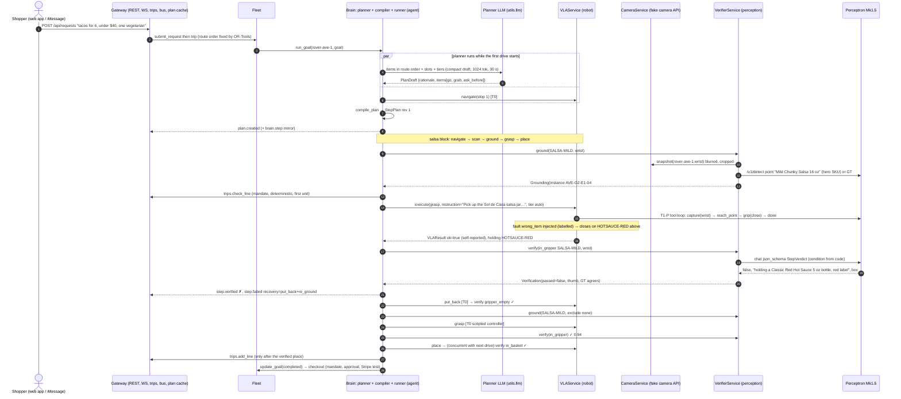
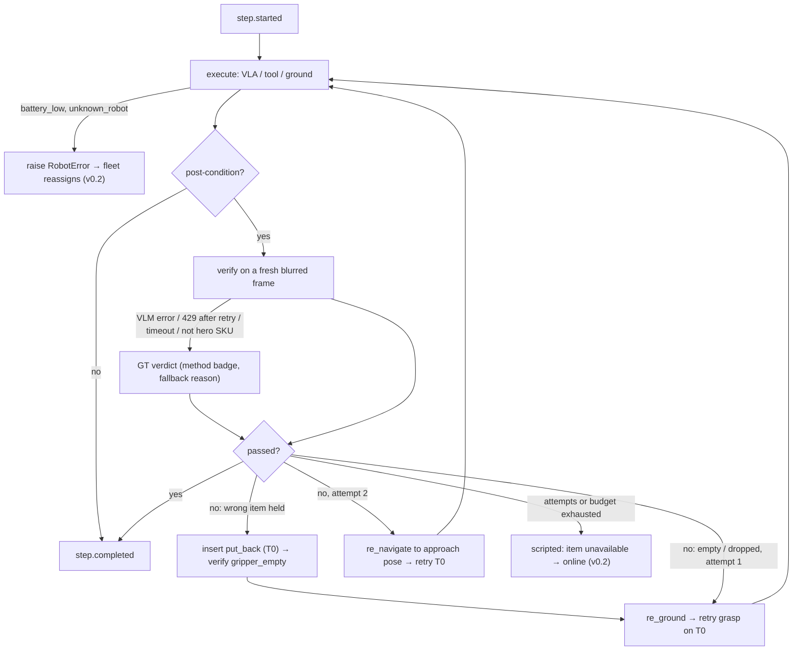

# Picky AI loop: LLM planner → VLA API → camera verifier (design rev 2, contracts 0.2.0 → 0.2.1)

Status: design proposal, **rev 2**, Sat Oct 17 2026, 18:45 PT. Rev 1 (18:33) was reviewed twice: once for repo and
feasibility, once for demo value and judging. §0.2 lists every review point and what happened to it. Rev 2 builds on
contracts v0.2 (`contracts/CHANGES-0.2.md`, still only on `chore/foundation`), the v0.2 robot brain
(`arms/agent/brain*.py`), the robot fake (`arms/robot/fake.py`, `render.py`), the cameras API
(`arms/perception/cameras.py`) and the research reports in this folder (`envs.md`, `robot.md`, `perceptron.md`,
`vla.md`).

Per CLAUDE.md §4 rule 4, every `contracts/` change below is a **proposal**. It ships as one `contracts/vla-loop` PR
that bumps `CONTRACTS_VERSION` to **0.2.1** (additive only) and updates the affected fakes in the same PR.

## 0. The decision in one screen

- **Step zero: get a base under it.** `origin/main` is still the bootstrap commit `d7ee623`. Foundation PR #1
  (`chore/foundation`, contracts v0.2) is an open draft, and `arm/frontend` branches from before v0.2. The lead merges
  PR #1 **with a merge commit** (CLAUDE.md §5), and every arm, starting with the frontend, merges `origin/main` before
  the loop contracts PR opens.
- **The loop.**
  - Natural language goes to `AgentService.interpret_request` (LLM #1, v0.2 as is). The fleet then picks the store,
    robot and route order deterministically (OR-Tools).
  - The **per-robot planner** (LLM #2, through `utils.llm`) returns a **compact per-item draft**: for each list item,
    one *go* instruction (movement to the location), one *grab* instruction (getting it off the shelf) and an
    *ask-before* flag. That is about 600 output tokens.
  - Deterministic code (`compile_plan`) expands the draft into a typed `StepPlan`:
    `navigate → scan → ground → grasp → place` per unit, in route order, with post-conditions written by code.
  - The motion steps (`navigate`, `grasp`, `put_back`, `place`, `unload`) go to the **VLA API** (`VLAService`) with the
    planner's instruction attached.
  - After each step the **verifier** checks the code-written post-condition on a fresh, face-blurred frame from the
    **camera API** (`CameraService`; the fake is the existing Pillow camera).
  - A deterministic recovery ladder handles failures. **A cart line exists only after a verified place.**
- **Perceptron** ("perceptron stuff" = Perceptron AI, sponsor of the DubHacks robotics track) does four jobs:
  - **acts** (P1): tier `t1_pretrained`, backend `perceptron-mk1.5-tools`, a Mk1.5 tool loop
    (`capture`, `reach_point`, `grip`, `done`) on the wrist frame;
  - **verifies** (P1): JSON-schema verdict with evidence and a box, on the hero SKUs;
  - **points** (P1): grasp grounding on the wrist frame;
  - **reads shelf tags** (P1b): one OCR call per demo scan feeds the mispricing alert.

  A ground-truth (GT) verifier on the same frames is the keyless fake and the fallback, so the loop runs with **no
  keys and no vhagar**.
- **VLA tiers tonight.**
  - T0 `t0_scripted`: A* + pure pursuit, magic grasp, scripted place, unload and put-back. Always on.
  - T1 `t1_pretrained`: Perceptron Mk1.5 tool-policy, grasp only. Needs the key.
  - **Labelled fault injection** (`wrong_item`, `grasp_miss`): an env var for CI and video, and a P1 "Perturb next
    grasp" button.
  - Cut: SmolVLA, GR00T and π0.5 in Isaac.
- **Isaac assets (found, not on the critical path).**
  - Store: **MarketGen `scenes/export20`**, used only for deck stills and video tonight.
  - Robot: **LeIsaac `lekiwi.usd` + our `picky_rover.usda`**. P2: a "visual puppet" in the worker, no physics.
  - The demo runs on the 2D fake.
- **Contracts 0.2.1.** Additive: `plan.py`, `vla.py`, two `Services` fields, six events, three REST lines. There are
  no `sim.py` changes and no changes to existing Protocols, so the Isaac worker does not need a redeploy.

### 0.1 Facts checked for rev 2 (Sat 18:40 PT)

| Fact | Where |
|---|---|
| `origin/main` = `d7ee623` (bootstrap); PR #1 open, draft; `chore/foundation` head `8ba1a6c` has v0.2 | `git log`, `gh pr view 1` |
| `arm/frontend` head `6fc1c41` (30 min old) lacks `8ba1a6c` | `git merge-base` |
| The gateway refuses a sim worker on a major.minor mismatch; patch differences are accepted | `contracts/sim.py:594`, `arms/gateway/app.py:806` |
| `complete_json` defaults to `max_tokens=2048`, retries once, then raises `LLMOutputError` | `utils/llm.py:181,262` |
| The Isaac worker uses set-pose; no physics timeline is played | `arms/sim/app.py:19-20` |
| A `front_cam_head` box (#111111) sits on the front-camera mount; near clip is 0.03 m. The Isaac front frame shows a black block | `scene_spec.py:712`, `app.py:551`, `vhagar/isaac2_rover-ave-1.front.jpg` |
| Fake frames leak answers: the HUD state word ("PLACING"), "holding Picky Farms · 1 ct · LIMES", a freshness line, and the "placing in basket" caption | `mid_wrist.jpg`, `mid_front.jpg` |
| The renderer prints `asset.label_text or name` on the unit. SALSA-MILD shows "Mild Chunky Salsa 16 oz" with a **green** label (`#4caf50`), so rev 1's "brown label" was wrong | `render.py:68`, `products.yaml:124` |
| `HOTSAUCE-RED` (AVE-G2-E2-04, z 1.05, red label) sits directly above `SALSA-MILD` (AVE-G2-E1-04, z 0.6), and both have the same approach pose | `store_ave.yaml:667-692` |
| Web app: `feed.ts` handles only `frame` and `robot.state` and silently drops other `/ws` types. There is no `brain.step` consumer and no GatewaySource yet (`APP_PLAN.md:138`). Its "sim" mode is a client-side engine, not a replay | `origin/arm/frontend` |
| The gateway's `/debug` page already renders `brain.step` | `arms/gateway/static/debug.html:137,357` |
| `ScanReport.shelf_tag_cents` and the catalog mispricing fields already exist (P1b OCR needs no contract change) | `contracts/perception.py:73`, `catalog.py:275,294` |
| LLM provider: the user switched to Gemini (memory, ~18:10 PT). `utils.llm` has only the Anthropic backend, and the repo has no Gemini code | `utils/llm.py:18`, `git grep` |

### 0.2 Review log: what changed from rev 1

**Applied:**

| # | Review point | Rev 2 |
|---|---|---|
| R1.1 | v0.3 was designed on a v0.2 that is not on `main` | Step zero: merge PR #1, then every arm merges `origin/main`, then the contracts PR (§5 #1) |
| R1.2 | About 23 person-hours for one beat with 4 people | Cut #11, #12 and #13. Robot and perception fakes go to one owner, gateway wiring to the same owner. The plan goes through `brain.step` first (see the R1.2 note under Modified). Budget in §5 |
| R1.3 | The Isaac rover plan contradicts set-pose | "Visual puppet" (§4.2): reference the usda, never press play, move the root Xform. P2 |
| R1.4 / R2.E | T1 SmolVLA in Isaac cannot work tonight | Cut, along with `PolicyGraspCmd`, the policy server and all of §3.6. T1 is now Perceptron Mk1.5 tool-policy |
| R1.5 / R2.A5 | No key means no Perceptron | §5 #0: key at the table now. Ask whether it is per-team (300 req/min is per org). Plan B: local Isaac-0.2-1B, time-boxed to 45 min |
| R1.6 | A 0.3.0 bump locks out the Isaac worker | Ship **0.2.1**. `sim.py` untouched. `get_plan` dropped: the gateway serves the plan from its cache of `plan.created` + `step.*` |
| R1.7 | The planner will always fall back (about 3k tokens > 2048; 30 s > 20 s) | Compact per-item `PlanDraft` (about 600 tokens), `max_tokens=1024`, 30 s timeout. The first deterministic navigate starts while the planner runs |
| R1.8 | A VLM on fake frames would give wrong verdicts | Condition text uses the renderer's own label string. Perception crops the HUD and caption bands. `PICKY_RENDER_HINTS=0`. Ground on the **wrist** frame. Point → instance by bbox hit-test. `pixel_ray` dropped |
| R1.9 | Strict schema with an optional field may 400 silently | `StepVerdict` fields are all required (`box: list[int]`, `[]` when none). Boot self-test. `/health` shows "vlm ok / fallback: reason". The UI shows a fallback counter |
| R1.10 / R2.B5 | Perceptron latency +30–80 s per trip | VLM only for `PICKY_VLM_SKUS=SALSA-MILD,AVOCADO`, GT elsewhere with a method badge. Place verify runs during the next drive. `RateLimitError` → one retry honoring `retry_after`, then GT |
| R1.11 | The VLA adapter in all modes changes CI's default path | `VLAService` is used only when `PICKY_BRAIN_MODE=plan`. The scripted and tools modes keep v0.2's direct robot calls |
| R1.12 | Isaac front camera self-occluded | Near clip 0.15 m (5 min sim fix) before any Isaac footage is recorded |
| R1.13 / R2.E | MarketGen as a third store | Cut from the loop. Stills and video for the deck via `isaac_render_marketgen.py`, with credit. If it is ever loaded, assert a bbox of about 16 × 12 m |
| R1.14 | GPU contention on the 5090 | At most one VLA effort on vhagar. The π0.5 runbook is shelved; if it runs as B-roll, set `XLA_PYTHON_CLIENT_PREALLOCATE=false`, and never during recording |
| R1.15 | The vhagar link is relayed and flaky | Isaac stays off the critical path; the 2D fake is the demo. Record Isaac early. If Isaac is live on stage, run the gateway on vhagar |
| R2.A1 | Make Mk1.5 the actor | T1 = `perceptron-mk1.5-tools` (P1). The arguments are physically validated, and the SKU is **not** checked, so the verifier still matters |
| R2.A2 | Drop `pixel_ray` | Done (same as R1.8) |
| R2.A4 | Verifier eval script | P1, the first hour with the key: 60 fake frames → confusion matrix vs GT, shown in the README, the deck and on screen ("Mk1.5 agreed with sim ground truth 23/24") |
| R2.A6 | Narration was false once Mk1.5 both acts and verifies | New line in §5.3 |
| R2.B1 | An empty-gripper miss is a weak showcase | Demo fault = `wrong_item:SALSA-MILD:1`: the grasp closes on the HOTSAUCE-RED unit above. A new `put_back` step returns it. `grasp_miss` stays as a second kind |
| R2.B2 | Fault injection should be visible | P1 `POST /api/fleet/robots/{id}/faults` + "Perturb next grasp" button. The env var stays for CI and video. Faults are always shown in `/health`, capabilities and the UI |
| R2.B3 | Render hints leak the answer | `PICKY_RENDER_HINTS=0` always on stage, plus the perception crop |
| R2.B4 | The UI cannot draw the box on the right frame | `Verification.thumb_jpeg_b64` (≤ 320 px, blurred) |
| R2.C | A 90 s beat vs a 30 s slot | §5.3: the Visa cut fits inside 1:05–1:35. A separate 60–90 s Perceptron-table cut |
| R2.D | Extend Trip/Live instead of a new Plan page | §5.4: item rows with five pips, a hero camera with the verdict overlay, an attribution ribbon, verified cart lines |
| R2.E | Shrink the contracts PR | Dropped: `PickResult/PlaceResult.verification`, the `BrainStep` additions, `/cameras/{id}/ground`, the P2 VLA POST, the `verify`/`look`/`add_item`/`update_progress`/`finish` step kinds, and the LLM re-plan (now P2) |
| R2.F | Open questions | Added to §6 |

**Modified or rejected:**

| # | Review point | Decision and reason |
|---|---|---|
| R1.2 (part) | "Mirror the plan into `brain.step` so the existing ThinkingLog carries it" | **Modified.** The web app has no `brain.step` consumer (`feed.ts` handles only `frame` and `robot.state`). The renderer that exists is the gateway's `/debug` page. So the `brain.step` mirror is P0 for `/debug`, CI and the backup video. The web app first needs GatewaySource, which is frontend P0 and was already on its checklist |
| R1.4 (opt) | Run SmolVLA on the Mac as a labelled "proposal" call | **Rejected for tonight.** Its action chunk would drive nothing, so showing it would be theatre and an honesty risk in front of judges. It stays a "later, physical SO-101" line in the deck |
| R1.7 (key) | "Get an Anthropic key" | **Modified.** The user switched the LLM provider to Gemini at about 18:10 PT, but `utils.llm` only speaks Anthropic. The planner calls `utils.llm` either way. The lead picks tonight's provider (§6 Q1). Gemini needs a `utils/gemini-backend` PR (about 1 h) before the planner is live |
| R2.A3 | Shelf-tag OCR at P1 | **Downgraded to P1b.** It needs no contract change, but it has the lowest value per hour among the Perceptron jobs. It runs only after the verifier, T1-P and the eval land, and only if a seeded mispriced tag renders in the fake |
| R2.D5 | "Use the web app's existing sim/replay mode" for `events.jsonl` | **Modified.** The "sim" mode is a client-side engine, not a replay. `make demo-loop` still writes `events.jsonl` (cheap). A `ReplaySource` that feeds the same reducer is new frontend P1 work (about 45 min) and becomes fallback rung 4 |
| R2.E (keep) | Keep `RobotBrainService.get_plan` | **Rejected.** R1.6's gateway cache needs no Protocol change and no stubs in two brain classes |
| R2.B5 (part) | "Fast-forward non-hero navigation" | **Deferred.** It is unverified that the robot fake has a time scale. Use a time-lapse in the video edit, and narrate over the drives live |
| — | Rev 1 open question 3: a 13th `vla` arm | Closed: `VLAService` is a robot-arm extra service, like `cameras` in perception |

---

## 1. The loop, end to end

### 1.1 Layers and who decides what

| Layer | Who | Decides | Never decides |
|---|---|---|---|
| Request understanding | `AgentService.interpret_request` (LLM #1, v0.2) | intent, list, budget, hints | store, robot, money |
| Fleet + trip | `FleetService` + gateway `TripController` (v0.2) | store split, robot, route order (OR-Tools), mandates | anything in the aisle |
| **Planner** | agent `planner.py` (LLM #2) | per item: the *go* and *grab* instructions, ask-before, a one-line rationale | ids, order, post-conditions, joints, cart, money |
| **Plan compiler** | agent `plan_compile.py` (code) | step expansion, route order, units, mandatory scan/ground, post-conditions from the catalog | - |
| **VLA API** | robot `VLAService` | *how* a motion step runs (tier, backend, timeouts); it self-reports only | whether the step succeeded |
| **Verifier** | perception `VerifierService` | pass/fail of a post-condition from camera frames | what to do next |
| **Step runner** | agent `step_runner.py` (code) | dispatch, recovery ladder, budgets, the cart gate | money; mandates and approvals stay in `trips.check_line` / `trips.ask` / `trust` as in v0.2 |

The LLM proposes and code decides. The planner never writes the verifier's condition, which is built from the catalog,
so the model cannot grade its own homework. It never emits joint angles, ids or order.

### 1.2 Sequence (demo path: a caught wrong item)



### 1.3 Step kinds and the compiler

| kind | executor | v0.2 tool it reuses | VLA tiers | post-condition (camera) | verifier |
|---|---|---|---|---|---|
| `navigate` | vla | `navigate_to` | T0 (A* + pure pursuit) | `at_pose(approach)` | odometry |
| `scan` | perception | `scan_shelf` | - | none | - (P1b: Mk1.5 tag OCR) |
| `ground` | verifier | new (was implicit in `pick_item`) | - | `found` | Perceptron `/v1/detect` point on the wrist frame (hero SKUs), else GT |
| `grasp` | vla | `pick_item` (keeps the `check_line` pre-hook) | T0 magic grasp · **T1 Mk1.5 tool-policy** | `in_gripper(sku)` (wrist) | VLM (hero) / GT |
| `put_back` | vla | new (recovery only, `inserted=True`) | T0 | `gripper_empty` (wrist) | GT |
| `place` | vla | `place_in_basket` | T0 | `in_basket(sku, n)` (basket) | VLM (hero) / GT, concurrent with the next drive |
| `ask_user` | human | `ask_user` (`trips.ask` / `approvals.request`) | - | none | - |
| `unload` | vla | `robot.unload_basket` | T0 | `basket_empty` (basket) | GT |

`locate_items` / `plan_route` run at planning time. `look`, `add_item`, `update_progress` and `finish` remain internal
brain operations and are not plan steps.

**Compiler rules** (`compile_plan(draft, goal, route, catalog) -> StepPlan`; deterministic, unit-tested):
1. Item blocks follow the trip route order (`RouteSummary`). Draft items with unknown `item_id`s are dropped, and
   each drop produces an `error` event. Goal items missing from the draft get a scripted instruction.
2. Per item: (`ask_user recommendation` before `navigate` when the item is optional or `ask_before`, with
   `on_decline=skip_item`) → `navigate` → `scan` → (`ask_user pick_choice` for produce) → for each unit:
   `ground` (first unit, or after a miss) → `grasp` → `place`.
3. `end_at == "checkout"` closes with `navigate(checkout)` → `unload`.
4. Code writes every post-condition from the kind plus the catalog. The draft's `go` goes to the navigate step title
   and the `grab` goes to `VLARequest.instruction`, which the T1 prompt uses verbatim.
5. Planner unavailable (no key, error, malformed output, 30 s timeout) → `scripted_plan(goal, route)`, the same shape
   with template instructions. The keyless loop and CI use this path.

**Condition text** (code templates; `label = product.asset.label_text or product.name`, the exact string the renderer
prints on the unit):
- `in_gripper`: "A {shape} with a {colour} label reading '{label}' is held between the two gripper jaws."
  Example: "A cylinder with a green label reading 'Mild Chunky Salsa 16 oz' is held between the two gripper jaws."
- `in_basket`: "The basket contains at least {n} item(s) with a {colour} label reading '{label}'."
- `gripper_empty`: "The gripper jaws are empty."
- `basket_empty`: "The basket is empty."

The brand appears only when the label prints it (`label_text`). Colour names come from a fixed hex → name table.

### 1.4 Planner (LLM #2)

- **Call:** `utils.llm.complete_json(messages, PlanDraft, system=PLANNER_SYSTEM, kind="brain", max_tokens=1024)` with
  a 30 s timeout. Prompt-cached system rules. The user turn carries items in route order (item_id, sku, name, brand,
  qty, slot level, `item_z_m`, optional + rec reason, produce flag), the robot's lift range and the available tiers.
- **System rules:**
  - One `go` and one `grab` sentence per item, physically specific ("grip the carton from the side; eggs are
    fragile").
  - Set `ask_before` for optional items and produce.
  - Never invent ids. You cannot pay.
- **Latency:** the runner starts `navigate` to the first route stop (deterministic) as soon as the goal arrives, so
  the plan lands while the robot drives.
- **Mid-goal `add_item`:** the compiler appends a scripted block and bumps the revision. An LLM revision is P2.
- **Re-plan with substitute / online (LLM):** P2. Tonight the scripted rule applies: the item becomes unavailable and is
  sourced online (v0.2 semantics).

```python
class DraftItem(Model):           # ~50 output tokens each; 12 items ≈ 600
    item_id: ItemId
    go: str = Field(description="One sentence: where to drive and what to look for.")
    grab: str = Field(description="One sentence for the grasp policy: how to take this product off the shelf.")
    ask_before: bool = Field(description="Ask the shopper first (optional detour, produce choice).")

class PlanDraft(Model):
    rationale: str = Field(description="One line shown above the plan.")
    items: list[DraftItem]
```

### 1.5 Step runner and the recovery ladder

The runner walks `StepPlan.steps`. For each step it emits `step.started`, dispatches it (vla → `VLAService.execute`;
perception / human → the existing `BrainExecutor` tool; verifier → `ground`), verifies `post`, then emits
`step.completed` or `step.failed`. Each event is mirrored as one `brain.step` (`tool_call` / `tool_result` /
`observation`), so `/debug` and CI show the loop with no UI work.



- **Budgets:** `max_attempts = 3` per step and `retry_budget = 8` per goal (`PICKY_STEP_RETRY_BUDGET`).
- **Timeouts:**
  - VLA: navigate 90 s, grasp T0 15 s, grasp T1 20 s (≤ 4 tool rounds), put_back and place 15 s.
  - Verifier: 8 s, then GT.
  - Planner: 30 s, then scripted.
- **The verifier decides.** A self-reported VLA success with the wrong item or an empty gripper fails the step.
- **Verifier disagreement (sim only):** the VLM verdict counts. If the VLM fails twice where GT passes, the step is
  accepted with `method=ground_truth`, the evidence says "VLM unsure; sim ground truth confirms", and an `error` event
  `verifier_disagreement` is emitted. This is logged honestly and counted in the UI.
- **Cart gate (Trust):** `_close_item` → `trips.add_line` runs only after the place is verified (VLM or GT). If no
  method can confirm, the brain asks: "I think the salsa is in my basket but my camera can't confirm it; add it?"
- **Stock:** `put_back` returns the unit to its own slot. Stock moves only on a verified place, so a wrong pick never
  shows up as a sale. The robot owner checks that `fake.pick` does not record a movement before the place.
- **Cancellation:** `VLAService.cancel` + `approvals.cancel`. The remaining steps become `cancelled`.
- **Safety net:** an unexpected runner exception → `error` event, and v0.2's `ScriptedRunner` finishes the goal from
  its current state.

### 1.6 Modes

`PICKY_BRAIN_MODE`:
- `scripted`: v0.2, the default until plan mode passes `make demo` + `make demo-loop`.
- `plan`: the step runner. LLM draft if a key is set, else `scripted_plan`.
- `tools`: the v0.2 tool loop.

**Only `plan` mode uses `VLAService`** (R1.11). `scripted` and `tools` keep v0.2's direct robot calls and timeouts.

---

## 2. Perceptron in the loop

Client: `arms/perception/perceptron_client.py`, using the `perceptron` SDK 0.4.0 (`AsyncClient`, one per event loop),
`PERCEPTRON_API_KEY`, model `perceptron-mk1.5`, base `https://api.perceptron.inc/v1`. `create_verifier()` **raises**
without the key or SDK, so the gateway boots the GT fake and `/health` says why.

**Boot self-test (R1.9):** one verify call on a known fake wrist frame. `/health.verifier` = `vlm ok (412 ms)` or
`ground_truth: <reason>` (no key, 400 schema, 401, 429, timeout). A strict-schema rejection therefore shows up at boot,
not as a silent GT demo. The UI shows "VLM fallbacks: n".

**Frame hygiene (R1.8, R2.B3; CLAUDE.md §8):**
- Frames come only from `CameraService.snapshot(camera_id, max_width=640)`. The client asserts `frame.blurred` before
  any network call.
- Before upload, perception crops the top HUD band (`PICKY_VLM_CROP_TOP=26` px: robot name, state word, battery) and
  the bottom caption band (`PICKY_VLM_CROP_BOTTOM=34` px: "placing in basket", "SIM · synthetic").
- `PICKY_RENDER_HINTS=0` (robot arm, about 15 min) removes the wrist "holding …" and freshness lines. It is always
  set on stage and whenever the verifier is a VLM.
- Only blurred, synthetic frames go to Perceptron. Add "Perceptron" to `docs/demo-script.md`'s "never say nothing leaves
  the store" line.

| Job | When | Call | Maps to | Keyless / fallback |
|---|---|---|---|---|
| **(a) Verify** (P1) | after `grasp` (wrist) and `place` (basket), hero SKUs only | `chat.completions.create(model, [image, prompt(cond.text)], response_format=pydantic_format(StepVerdict, strict=True), reasoning_effort="low", max_completion_tokens=300, timeout=8)` | `Verification(method="vlm")`; the 0–1000 box → pixel `BBox`; `ground_truth` filled in sim | GT table below |
| **(b) Ground** (P1) | `ground` before the first unit and after a miss; **wrist** frame aimed at the slot | `POST /v1/detect {"media", "categories": [label], "config": {"output": "point"}}` | point → the `frame.instances[i].bbox` that contains it → `instance_id`; no hit → GT + `error` event | first unit of the slot in `frame.instances`, skipping `exclude_instance_ids` |
| **(c) Act: T1-P** (P1) | `grasp` with tier `t1_pretrained` | Mk1.5 tool loop (≤ 4 rounds): `capture(camera)`, `reach_point(x, y)` (0–1000 grid), `grip(close)`, `done(success, reason)`; the prompt is the planner's `grab` instruction | the robot validates **physics only** (point inside a unit bbox of the aimed slot's frame, within reach, at most one grip) and never checks the SKU, then picks **that** instance. `VLAResult.trace` = the tool calls | unavailable → T0 (`VLAResult.tier` says what ran) |
| **(d) Shelf-tag OCR** (P1b) | the demo-aisle `scan`, `PICKY_SCAN_VLM=1` | JSON-schema `{tags:[{label, price}]}` on the front frame (tags render large: "$1.29") | `ScanReport.shelf_tag_cents` → catalog mispricing alert (merchant flip, 2:45) | current GT `identify` |

```python
class StepVerdict(BaseModel):          # perception-private wire model; strict=True → every field required
    success: bool
    confidence: float                  # self-reported, uncalibrated: displayed; gate = success and >= 0.5
    evidence: str                      # one sentence: what in the frame decided it
    box: list[int]                     # [x1, y1, x2, y2] on the 0-1000 grid, [] when none
```

**Latency and rate (R1.10):**
- Calls per trip with hero SKUs SALSA-MILD and AVOCADO (3 avocado units): about 2 grounds + 4 grasp verifies +
  2 place verifies + T1 rounds (≤ 4 per hero grasp). That is roughly 20 calls, +10–20 s, with the place verifies
  overlapping the drives.
- The other items use GT and carry a "sim ground truth" method badge, so nothing is hidden.
- `RateLimitError` → one retry after `retry_after`, then GT.
- 300 req/min per org: confirm at the table that the key is ours, not a shared hackathon org.

**Eval first (R2.A4; P1, about 1 h, about $0.05):** `python -m arms.perception.eval_verifier` renders about 60 fake
frames (right item held, wrong item held, empty gripper, basket counts 0–3; hints off, cropped) and runs Mk1.5 against
GT. The confusion matrix goes in the README and the deck, and the live counter shows "Mk1.5 agreed with sim ground truth
n/m". If agreement is below 90%, crop to the slot bbox before upload (perception). If it is still below, enlarge the
unit labels (robot `render.py`, owner review).

**Plan B, no key by 8 PM (time-boxed 45 min, perception owner):** run `PerceptronAI/Isaac-0.2-1B` (5.1 GB, CC-BY-NC,
transformers `trust_remote_code`) locally on the Mac (MPS) or vhagar. It covers verify and ground only, not T1-P. If
that also fails, say plainly: "Perceptron is key-gated; tonight the verifier runs on sim ground truth with the same
contract."

**Ground-truth verifier** (`create_verifier_fake`, also the fallback inside the real one; "the verifier tied to the
fake camera API"):

| condition | frame | rule (`method="ground_truth"`, confidence 1.0) |
|---|---|---|
| `at_pose` | none | `robot.state().pose` within 0.10 m / 0.10 rad (`method="odometry"`) |
| `found` (ground) | wrist | a unit of the slot with `sku` in `frame.instances`, not excluded |
| `in_gripper` | wrist | `state.holding` is set **and** that instance is in `frame.instances` **and** its `sku == post.sku`. A held HOTSAUCE-RED fails with "wrist frame f_…: gripper holds HOTSAUCE-RED, expected SALSA-MILD" |
| `gripper_empty` | wrist | `state.holding is None` |
| `in_basket` | basket | `count(i.in_basket and i.sku == sku) >= n`, cross-checked with `state.basket_skus` |
| `basket_empty` | basket | no basket instances |

**Fake camera API expectations** (in the `contracts/vla.py` docstring; Isaac frames must meet them too):
1. The wrist frame while holding shows only the held unit, and `instances == [held]` with a bbox. When not holding and
   aimed at a slot, it shows that slot's front units, large and labelled, with bboxes (`render.py:447`). Check that the
   aim follows the target slot at the approach pose.
2. The basket frame lists every basket unit with a bbox.
3. Every frame is blurred by perception before it is served, and keeps `instances` through downscaling.
4. Deterministic: the same world state gives the same pixels and instances. `frame_id` is unique.
5. With `PICKY_RENDER_HINTS=0`, no text gives away the answer outside the unit's own printed label.
6. After a miss, the unit is still on the shelf. After `put_back`, the unit is back in its own slot.

---

## 3. Contracts 0.2.1 (`contracts/vla-loop` PR)

- **Additive only.** `CONTRACTS_VERSION = "0.2.1"`. `versions_compatible` compares major.minor, so the Isaac worker
  (which sees no wire change) keeps connecting without a redeploy. Semver would call this a minor bump; we use patch
  because the only version-pinned peer is unaffected.
- **Affected arms:** agent, robot, perception, gateway, frontend (`make gen-types`).
- **Stub fakes in the same PR:** `create_vla_fake` (T0 passthrough) and `create_verifier_fake` (GT).
- **Settings:** a separate small `utils/vla-settings` PR.

**`contracts/plan.py`** (new; producer: agent)

```python
PlanId = str
VLATier = Literal["t0_scripted", "t1_pretrained", "t2_finetuned"]
PlanStepKind = Literal["navigate", "scan", "ground", "grasp", "put_back", "place", "ask_user", "unload"]
StepExecutor = Literal["vla", "perception", "verifier", "human"]
STEP_EXECUTOR: dict[str, StepExecutor] = {"navigate": "vla", "grasp": "vla", "put_back": "vla", "place": "vla",
    "unload": "vla", "scan": "perception", "ground": "verifier", "ask_user": "human"}
ConditionKind = Literal["at_pose", "found", "in_gripper", "gripper_empty", "in_basket", "basket_empty"]

class DraftItem(Model): ...            # §1.4 (LLM output)
class PlanDraft(Model): ...            # §1.4

class PostCondition(Model):            # built by CODE from kind + catalog, never by the LLM
    kind: ConditionKind
    camera: RobotCameraKind = "wrist"
    sku: Sku | None = None
    count: int = Field(1, ge=0)
    pose: Pose2D | None = None
    text: str                          # §1.3 templates
    vlm: bool = False                  # True only for PICKY_VLM_SKUS

class StepTarget(Model):
    nav: NavTarget | None = None; slot_id: SlotId | None = None; stop_id: StopId | None = None
    sku: Sku | None = None; unit: int | None = Field(None, ge=1); instance_id: InstanceId | None = None
    pose: Pose2D | None = None; question: str | None = None; ask_kind: AskKind | None = None
    options: list[str] = Field(default_factory=list)

StepStatus = Literal["pending", "running", "verifying", "passed", "failed", "retrying", "skipped", "cancelled"]
RecoveryAction = Literal["retry", "put_back", "re_ground", "fallback_tier", "re_navigate", "ask_user", "skip_item",
                         "give_up"]

class PlanStep(Model):
    step_id: StepId; index: int; kind: PlanStepKind; title: str; instruction: str = ""
    item_id: ItemId | None = None; target: StepTarget = Field(default_factory=StepTarget)
    post: PostCondition | None = None; tier: VLATier | Literal["auto"] = "auto"
    on_decline: Literal["skip_item", "continue"] = "continue"; max_attempts: int = 3
    status: StepStatus = "pending"; attempts: int = 0; inserted: bool = False; last_code: str | None = None
    # computed: executor = STEP_EXECUTOR[kind]

class StepPlan(Model):
    plan_id: PlanId; goal_id: GoalId; robot_id: RobotId; store_id: StoreId; trip_id: TripId | None = None
    revision: int = 1; reason: str = "initial"; planner: str  # model id | "scripted"
    rationale: str = ""; steps: list[PlanStep] = []; retry_budget: int = 8; retries_used: int = 0
    created_at: Timestamp
    # computed: progress

def product_label(p: Product) -> str:  # the exact string the renderer prints on a unit
    return p.asset.label_text or p.name
```

**`contracts/vla.py`** (new; VLA part: robot, verifier part: perception)

```python
VLAStepKind = Literal["navigate", "grasp", "put_back", "place", "unload"]
VLAPhase = Literal["queued", "running", "succeeded", "failed", "cancelled"]
VLAResultCode = Literal["ok", "grasp_failed", "no_instance", "unreachable", "path_blocked", "timeout",
                        "policy_unavailable", "policy_gave_up", "busy", "disconnected", "cancelled", "internal"]
FaultKind = Literal["wrong_item", "grasp_miss"]

class VLARequest(Model):  request_id; robot_id; goal_id; plan_id; step_id; kind: VLAStepKind; instruction: str
                          target: StepTarget; waypoints: list[Pose2D] = []; tier: VLATier | "auto"; timeout_s; attempt
class VLAResult(Model):   ok; code; tier; backend  # "planner+pure_pursuit" | "magic_grasp" | "perceptron-mk1.5-tools"
                          self_reported: bool = True; instance: ItemInstance | None; fault: FaultKind | None
                          trace: list[str] = []  # T1-P tool calls, e.g. "reach_point(512,430)"
                          duration_ms; note
class VLAStatus(Model):   request_id; robot_id; step_id; phase; tier; backend; note; result: VLAResult | None; ts
class VLATierInfo(Model): tier; available: bool; backend: str; kinds: list[VLAStepKind]; reason: str = ""
class VLACapabilities(Model): robot_id; tiers: list[VLATierInfo]; default_tier: dict[str, VLATier]
                          faults: list[str] = []  # armed faults; never hidden
class FaultRequest(Model): kind: FaultKind; sku: Sku | None = None; count: int = 1   # next grasp(s)

VerificationMethod = Literal["vlm", "ground_truth", "odometry"]
class Verification(Model): verification_id; robot_id; plan_id; step_id; condition: PostCondition; passed: bool
                          confidence: Score01; evidence: str; boxes: list[BBox] = []; camera_id; frame_id
                          method: VerificationMethod; model: str | None; ground_truth: bool | None
                          fallback: bool = False; fallback_reason: str = ""; latency_ms: float = 0
                          thumb_jpeg_b64: str | None = None  # <= 320 px, blurred, the frame that was judged
class GroundRequest(Model): robot_id; step_id; camera: RobotCameraKind = "wrist"; sku; slot_id; label: str
                          exclude_instance_ids: list[InstanceId] = []
class Grounding(Model):   found; point_px: tuple[float, float] | None; box: BBox | None; instance_id: InstanceId | None
                          confidence; camera_id; frame_id; method: Literal["vlm", "ground_truth"]; model; fallback
                          latency_ms
```

**`contracts/services.py`** (additive)

```python
class VLAService(Protocol):          # robot: create_vla / create_vla_fake → Services.vla
    def execute(self, request: VLARequest) -> AsyncIterator[VLAStatus]: ...   # last item terminal, with result
    async def cancel(self, robot_id: RobotId, request_id: str | None = None, reason: str = "") -> bool: ...
    async def capabilities(self, robot_id: RobotId) -> VLACapabilities: ...
    async def inject_fault(self, robot_id: RobotId, fault: FaultRequest) -> VLACapabilities: ...

class VerifierService(Protocol):     # perception: create_verifier / create_verifier_fake → Services.verifier
    async def verify(self, robot_id: RobotId, step: PlanStep, frames: list[CameraFrame] | None = None, *,
                     plan_id: PlanId | None = None) -> Verification: ...   # never raises for model/network errors
    async def ground(self, request: GroundRequest) -> Grounding: ...
    def info(self) -> dict[str, Any]: ...   # {"mode", "model", "self_test", "fallbacks"} for /health

# Services: vla: VLAService | None = None; verifier: VerifierService | None = None
# EXTRA_SERVICE_PROTOCOLS / SERVICE_FACTORIES += vla (robot), verifier (perception)
```

**`contracts/events.py`** (producer: agent; `goal_envelope(goal)`):
- `plan.created {plan}`
- `step.started {plan_id, step, attempt}`
- `vla.status {plan_id, step_id, status}` (≤ 2 Hz per robot, plus every phase change)
- `step.verified {plan_id, step_id, attempt, verification}`
- `step.failed {plan_id, step_id, attempt, code, recovery, will_retry, note}`
- `step.completed {plan_id, step_id, status, attempts, summary}`

The web app ignores unknown `/ws` types today (`feed.ts`), so adding them is safe.

**`contracts/api.md`:**

| Endpoint | Returns | Backed by |
|---|---|---|
| `GET /api/goals/{goal_id}/plan` | `StepPlan` (404 when none) | gateway cache: the last `plan.created`, with step statuses folded in from `step.*` |
| `GET /api/fleet/robots/{robot_id}/vla` | `VLACapabilities` | `vla.capabilities` |
| `POST /api/fleet/robots/{robot_id}/faults` (P1) | `FaultRequest` → `VLACapabilities`; 403 unless `PICKY_ALLOW_FAULTS=1` | `vla.inject_fault` |

`/health` adds `verifier` (`info()`), the VLA tiers and the armed faults.

**Not changed (R1.6, R2.E):** `sim.py`, `RobotBrainService`, `tools.PickResult/PlaceResult`, `fleet.BrainStep`.

**Settings** (`utils/vla-settings` PR, plus `.env.example`):

| Key | Default | Meaning |
|---|---|---|
| `PERCEPTRON_API_KEY` | blank | blank → GT verifier, T1 unavailable |
| `PERCEPTRON_MODEL` | `perceptron-mk1.5` | |
| `PICKY_BRAIN_MODE` | `scripted` (→ `plan` after #12) | `plan` / `tools` / `scripted` |
| `PICKY_PLANNER_TIMEOUT_S` | `30` | then `scripted_plan` |
| `PICKY_VERIFY` | `auto` | `auto` (VLM for hero SKUs if key) / `ground_truth` |
| `PICKY_VLM_SKUS` | `SALSA-MILD,AVOCADO` | VLM verify, ground and T1 only for these; `*` = all |
| `PICKY_VLM_CROP_TOP` / `_BOTTOM` | `26` / `34` | px cropped before upload |
| `PICKY_VLA_GRASP_TIER` | `auto` | `auto` (T1 for hero SKUs if available) / `t0` / `t1` |
| `PICKY_VLA_FAULTS` | blank | e.g. `wrong_item:SALSA-MILD:1`; shown in `/health`, capabilities and the UI |
| `PICKY_ALLOW_FAULTS` | `1` in dev | enables the fault endpoint and button |
| `PICKY_RENDER_HINTS` | `1` (`0` on stage / with a VLM) | answer-leaking text on fake frames |
| `PICKY_STEP_RETRY_BUDGET` | `8` | per goal |

Add `perceptron>=0.4.0` to the `perception` extra.

**Ownership** (CLAUDE.md §4):

| Arm | Owns | Files |
|---|---|---|
| contracts (lead) | the 0.2.1 PR + `CHANGES-0.2.1.md` | `contracts/plan.py`, `vla.py`, `services.py`, `events.py`, `api.md` |
| agent | planner, `compile_plan`, `scripted_plan`, runner, recovery, events, `brain.step` mirror | `arms/agent/planner.py`, `plan_compile.py`, `step_runner.py`, `brain.py` (mode) |
| robot | `VLAService`: T0, T1-P tool loop, faults + `put_back`, capabilities; `PICKY_RENDER_HINTS` | `arms/robot/vla.py`, `vla_fake.py`, `vla_perceptron.py`, `render.py` |
| perception | `VerifierService` (GT + Mk1.5), grounding, crop, self-test, eval, P1b tag OCR | `arms/perception/verifier.py`, `perceptron_client.py`, `eval_verifier.py` |
| gateway | registry fields, plan cache, 3 endpoints, `/health`, `/debug` plan list, `make demo-loop` + `events.jsonl` | `registry.py`, `app.py`, `demo.py`, `static/debug.html` |
| frontend | GatewaySource, plan rows, verdict overlay, attribution ribbon, fault button, ReplaySource | `arms/frontend` |
| sim | near-clip fix, footage, MarketGen stills, P2 visual puppet | `arms/sim/app.py`, `scene_spec.py` |

T1-P lives in robot, not perception: it is a VLA *tier*. It calls Perceptron through its own thin client in
`arms/robot`, because arms never import each other. The duplicated client is about 40 lines.

---

## 4. Isaac assets and scene

### 4.1 Picks

| | Pick (found) | Tonight's role | Fallback |
|---|---|---|---|
| **Supermarket** | **MarketGen `scenes/export20`**: HF `HXX/MarketGen`, ungated, CC BY-NC-SA 4.0, 1.72 GB, 16 × 12 m L-shape, every grocery zone; `ConvenienceStore.usd` (no physics). `export04` (0.63 GB, produce-heavy) | Deck and README **stills and video only**, via `isaac_render_marketgen.py` (opens the stage directly), credited, kept out of SideShift commercial claims. Not a loop store (R1.13) | GRScenes commercial `MWF4WLIKTIFZIAABAAAAACY8_usd`; the loop store is the planogram-generated `store_ave` (primitive Isaac scene, Sketch worker, 2D fake) |
| **Rover + arm** | **LeIsaac `lekiwi.usd` + `picky_rover.usda`** (Apache-2.0; SO-101 joints named `shoulder_pan … gripper`). The overlay adds a prismatic lift (0–1.08 m; shoulder 0.12–1.2 m), mast, rear basket and 3 cameras (`scratchpad/picky-rover/`) | **P2 visual puppet** in the worker (§4.2) | the current primitive `RoverSpec` (base + mast + lift + primitive SO-101 + basket) |

### 4.2 Visual puppet (P2, about 1–1.5 h, RTX + sim; R1.3)

`picky_rover.usda` / `lekiwi.usd` keeps the links as flat siblings under `/LeKiwi` (`base`, `shoulder`, `upper_arm`,
`lower_arm`, `wrist`, `gripper`, `jaw`, `lift_carriage`), joined only by physics joints. The worker never plays physics,
so setting joint values moves nothing.
- Reference the usda at `/World/Stores/<store>/Robots/<robot_id>` and **never press play**.
- Pose: set the **root Xform** translate to the store-local pose, with rotate = θ + π/2 (the arm points to −Y at 0).
- Lift: add Δz = `clamp(lift − 0.119, 0, 1.08) − authored` to `lift_carriage` and to the 6 arm-link translates.
- Arm: keep the authored pose. Hand-written FK for arm motion is P2+ and not tonight.
- Magic grasp: keep `set_instance_pose` with the held unit following the `gripper` link's world pose; on place,
  `BASKET_OFFSET_LOCAL`.
- Cameras: the worker's own `CameraPose`s stay authoritative. The overlay camera prims are unused.
- `isaac_check_rover.py`: without physics, USD XformCache readback is valid. The Fabric-staleness concern applies only
  if physics is ever enabled.

### 4.3 Worker fixes and host rules

- **Near clip (R1.12, 5 min):** `CreateClippingRangeAttr(Gf.Vec2f(0.15, 200.0))` in `app.py:551` (or move
  `front_cam_head` 5 cm behind the mount). Do this before recording any Isaac footage.
- **GPU (R1.14):** at most one VLA effort on the 5090. The π0.5 sim-evals runbook is shelved. If the RTX teammate runs
  it as B-roll after the Isaac footage, use `XLA_PYTHON_CLIENT_PREALLOCATE=false` and never during recording.
- **Link (R1.15):** vhagar is reached over a DERP relay. The 2D fake is the demo. Record Isaac early. If Isaac is live
  on stage, run the gateway **on vhagar** so `/ws/sim` is local.
- **Fallback chain:** Isaac primitive `store_ave` (+ puppet rover, P2) → Sketch worker on the Mac
  (`--backend sketch`) → the in-process 2D fake. The loop is identical on every rung. On the fake only, fault injection
  and `put_back` are supported tonight.
- **Version note:** vhagar runs Isaac 6.0.0-rc.59 (CLAUDE.md says 6.2). Use pxr-level APIs only.

---

## 5. Build plan for tonight

Team: **Lead** (contracts + agent arm, with parallel Claude agents), **Backend** (robot + perception + gateway
wiring), **Frontend** (web app), **RTX** (vhagar / sim). The clock starts Sat 6:50 PM PT. Targets:
- **about 10:45 PM:** keyless loop on `main` (CLAUDE.md wanted 9–10 PM; `main` has no v0.2 yet);
- **5:30 AM:** feature freeze;
- **8:00 AM:** code freeze.

### 5.1 Tasks

| # | When (PT) | Task | Owner | h | Needs |
|---|---|---|---|---|---|
| **P0** | | | | | |
| 0 | 6:50–7:05 | Perceptron table: key, per-team or shared org, credits, judging criteria (does VLM-as-policy count?), hosted Isaac 0.5?, SO-101 on site?, may judges press a fault button? Decide tonight's LLM provider (§6 Q1) | Lead | 0.25 | - |
| 1 | 7:05–7:20 | `make check` on `chore/foundation`, merge PR #1 **with a merge commit**, announce. Every arm merges `origin/main` (frontend first: 14 commits behind) | Lead (+ each owner) | 0.75 | - |
| 2 | 7:15–8:00 | `contracts/vla-loop` 0.2.1 PR (§3) + stub fakes; `utils/vla-settings` PR. Review: Backend | Lead | 1.0 | - |
| 3 | 8:00–9:45 | VLA fake: T0 passthrough, faults `wrong_item` / `grasp_miss`, `put_back`, capabilities, `inject_fault`; `PICKY_RENDER_HINTS`. GT verifier + GT grounding on the wrist frame (bbox hit-test); crop helper. Built on the contracts branch | Backend | 1.75 | - |
| 4 | 8:00–10:30 | `scripted_plan` + `compile_plan` + runner + recovery (`put_back`, re-ground, re-navigate) + 6 events + `brain.step` mirror + compact LLM planner with mocked-client tests, behind `PICKY_BRAIN_MODE=plan` | Lead | 2.5 | - |
| 5 | 9:45–10:30 | Gateway: registry fields, plan cache, `GET plan`, `GET vla`, `/health` verifier and faults, `/debug` plan + verdict list; `make demo-loop` asserts "verifier caught wrong_item on SALSA-MILD, put back, recovered; cart line only after the verified place" and writes `events.jsonl` | Backend | 0.75 | - |
| 6 | 7:20–10:30 | Frontend: merge main, **GatewaySource** (`/ws`, `head`→`front`, `brain.step` + the 6 plan events into the store) | Frontend | 3.0 | - |
| 7 | 7:00–8:15 | vhagar access; near-clip fix PR; record the current Isaac `store_ave` footage; MarketGen stills | RTX | 1.25 | vhagar |
| ✔ | **about 10:45 PM** | **Keyless loop on `main`:** `PICKY_BRAIN_MODE=plan PICKY_VLA_FAULTS=wrong_item:SALSA-MILD:1 make demo-loop`, visible on `/debug` | all | | none |
| **P1** | | | | | |
| 8 | key + 0:00–1:00 | Perceptron client, boot self-test, `/health`, then the **eval script** (confusion matrix) before anything else is built on it | Backend | 1.0 | PERCEPTRON |
| 9 | 11:45–1:45 | Mk1.5 verifier on hero SKUs + wrist grounding + 429 retry + concurrent place verify + thumbnails | Backend | 2.0 | PERCEPTRON |
| 10 | 10:45–12:45 | T1-P `perceptron-mk1.5-tools` grasp tier (robot arm, owner review) | Lead | 2.0 | PERCEPTRON |
| 11 | 10:30–1:30 | Plan item rows (5 pips), active-row tier badge + attempts, hero camera with the frozen verdict thumbnail + box, attribution ribbon, "verified by camera" cart lines | Frontend | 3.0 | - |
| 12 | ~1:00 | Flip the `PICKY_BRAIN_MODE` default to `plan` once `make demo` + `make demo-loop` are green with the planner live | Lead | 0.25 | LLM key |
| 13 | 1:45–2:15 | Fault endpoint (gateway) + "Perturb next grasp" button (frontend) | Backend + Frontend | 0.75 | - |
| 14 | 1:30–2:15 | `ReplaySource` for `events.jsonl` (fallback rung 4) | Frontend | 0.75 | - |
| 15 | 2:15–3:15 | (P1b) Shelf-tag OCR on the demo-aisle scan → `shelf_tag_cents` → mispricing alert; only if #8–#10 have landed | Backend | 1.0 | PERCEPTRON |
| **P2** | | | | | |
| 16 | when vhagar is up, stop at 3 AM | Isaac visual-puppet rover (§4.2) + footage | RTX | 1.5 | vhagar |
| 17 | spare | LLM re-plan (substitute / online via `ask_user substitution`); LLM `add_item` revisions | Lead | 1.0 | LLM key |
| **Freeze** | | | | | |
| 18 | 4:30–5:30 | Backup videos (keyless loop; Perceptron loop if keyed; Isaac B-roll), rehearse both cuts | all | 4 × 1.0 | |

**Budget:** P0 ≈ 11.5 person-hours, P1 ≈ 10.75, P2 ≈ 2.5, freeze 4, for a total of about 29 of the about 42
available (4 people × 10.5 h). That leaves about 13 person-hours for the rest of P0: Stripe/Visa checkout, Photon,
trip 2 and Cart Whisperer. If those are behind at 11 PM, cut P1 in this order: #15, #14, #13, #10.

**Cut tonight:**
- SmolVLA, GR00T and π0.5 in Isaac;
- `PolicyGraspCmd`, the policy server, the `sim.py` changes;
- MarketGen as a store;
- `pixel_ray`;
- `get_plan` on the Protocol;
- `PickResult/PlaceResult.verification`, the `BrainStep` additions, `/cameras/{id}/ground|verify`;
- SmolVLA-on-Mac "proposal" calls.

**Runs with no keys:** the whole loop (scripted plan, T0, labelled faults, GT verifier and grounding, all events,
`/debug`, CI).
- `PERCEPTRON_API_KEY` adds T1-P, VLM verify and grounding, the eval and tag OCR.
- An LLM key adds the planner draft.
- vhagar adds Isaac footage.

### 5.2 What "done" looks like per checkpoint

- **10:45 PM:** `make demo-loop` is green in CI. `/debug` shows the plan list, step ticks, the red then green verdict
  with GT evidence, and the cart line appearing only after the verified place.
- **2 AM:** the same trip with Perceptron on the salsa and avocado. T1-P trace in `vla.status`. Eval numbers in the
  README. Web app plan rows and verdict overlay live over GatewaySource.
- **5:30 AM:** backup videos recorded; both cuts rehearsed.

### 5.3 Demo beats

**Visa cut, inside the existing 1:05–1:35 slot (30 s):**
- 5 s: the plan unfolds. "Planned by <model>" + the rationale. Item rows in route order.
- 15 s: the salsa hero.
  - The Grab row shows the literal instruction sent to the VLA API.
  - The wrist camera shows the Mk1.5 point.
  - The verdict freezes red with a box on the hot sauce: "Holding a Classic Red Hot Sauce 5 oz bottle; expected Mild
    Chunky Salsa 16 oz". Badge "fault injected" (or "judge perturbed").
  - "put back → re-find → scripted controller". Green at 0.94.
  - The basket check goes green, and only then does the cart line appear with "verified by camera".
- 10 s: the rest of the trip, time-lapsed (video) or narrated (live), covering the avocado top-3 and the detour ask.
- Line: "Nothing reaches your cart unless the camera confirms it."

**Perceptron-table cut (60–90 s):**
1. The plan.
2. The live Mk1.5 tool trace: `capture(wrist)` → `reach_point(512,430)` → `grip(close)` → `done`.
3. A judge presses **Perturb next grasp**. The verifier catches it and the robot puts the item back and recovers.
4. (P1b) The shelf-tag mispricing alert.
5. "Mk1.5 agreed with sim ground truth n/m."
6. "Isaac 0.5 and its LeRobot SO-101 path is our physical-arm path."

**Narration (R2.A6):** "<Model> plans, Perceptron acts, and Perceptron checks independently: a fresh frame from a
different camera, against a condition written by code, never by the robot, and cross-checked with sim ground truth."
When T1-P is off, say "a scripted controller acts". **Never call magic grasp a VLA.**

### 5.4 Web app (extend Trip/Live; no new page)

1. **Plan as item rows**, one per list item, each with five pips: Go, Scan, Find, Grab, Bag.
   - Only the active row expands: the step title, the planner's instruction, a tier badge ("Perceptron Mk1.5
     tool-policy" or "scripted controller"), the attempt count with a retry arrow.
   - Header: planner, revision, rationale.
2. **Hero camera with the verdict overlay.**
   - During Find: the Mk1.5 point.
   - At the verdict: freeze `thumb_jpeg_b64` for about 2 s with the box, a red or green border, the evidence, a
     method badge + latency, "sim ground truth agrees", and a "faces blurred" chip.
3. **Attribution ribbon:** <model> plans · Perceptron points / acts / verifies · code: route, money, cart gate.
4. **Cart:** lines appear only after a verified place, each with a camera icon.
5. Fallback counter ("VLM fallbacks: n") and the armed-fault badge, both always visible.

Insurance: if GatewaySource is not live by 1 AM, the stage view is `/debug` (plan + verdict list from #5).

---

## 6. Risks and open questions

| Risk | Impact | Mitigation |
|---|---|---|
| PR #1 not merged, so arms build on different bases | broken `main`, frontend drift | §5 #1 before anything else |
| No Perceptron key, or a shared org key that hits 429 in judging | no Perceptron in the demo | Get the key now and ask whether it is per-team; Plan B local Isaac-0.2-1B (45 min); GT with the same contract, said plainly |
| Strict schema 400 → silent GT | Perceptron never runs | All-required `StepVerdict`; boot self-test; `/health`; UI fallback counter |
| Mk1.5 misreads Pillow frames | false negatives, retry loops | Eval first; crop bands; hints off; labels from the renderer's string; slot crop; disagreement rule; GT cross-check |
| Planner truncation or timeouts | always scripted | Compact draft ≤ 1024 tokens, 30 s, first drive in parallel; scripted plan has the same shape |
| LLM provider undecided (Gemini decision vs Anthropic-only `utils.llm`) | no "LLM splits NL into steps" beat | §6 Q1 tonight; a Gemini backend is a `utils/` PR before #4 lands |
| Frontend not wired by freeze | the loop is invisible on stage | `brain.step` mirror + `/debug` plan list (P0); `ReplaySource` (P1) |
| Latency with VLM + T1 | slow trip on stage | Hero SKUs only; place verify during drives; T1 ≤ 4 rounds / 20 s |
| Wrong pick leaks into stock or cart | Trust/Commerce error | Stock and cart move only on a verified place; `put_back` restores the slot |
| vhagar flaky / relayed | no Isaac | Off the critical path; footage early; gateway on vhagar if live |
| GPU contention | OOM | One VLA effort at most; no prealloc; none during recording |
| Licences (MarketGen CC BY-NC-SA, Isaac-0.2 CC-BY-NC) | SideShift story | Credit; demo and deck only; the commercial path is our planogram store + hosted Mk1.5 |
| Frames leave for Perceptron's cloud | Trust | Blurred, synthetic, cropped frames only (asserted); say so |

**Open questions for the lead (answer before #2 merges):**
1. **LLM provider tonight:**
   - Gemini, per the ~18:10 decision. That needs a `utils.llm` Gemini backend PR (about 1 h).
   - Or Claude, which `utils.llm` and CLAUDE.md §9 support today and only needs a key.
   - Which key exists right now?
2. **Perceptron:**
   - Is the key per-team?
   - Does VLM-as-policy (T1-P) count for the track?
   - Is a judge-pressed fault button OK?
   - Do they host Isaac 0.5, or did they bring an SO-101?
3. Who owns the frontend's GatewaySource tonight? It comes before any loop UI.
4. Is the 0.2.1 patch bump (no worker redeploy) OK with the agent, robot and perception owners?
5. If the Pillow labels fail the eval even after cropping, may perception ask robot to enlarge unit labels in
   `render.py`?
6. Cart gate from tonight (recommended; GT makes it safe) or only after the rehearsal?
7. Where are checkout, Photon and trip 2 at 11 PM? Their state decides how much of P1 survives.
8. Does the teammate's Franka job need vhagar's GPU overnight?

## Appendix: sources

- Contracts: `contracts/services.py`, `sim.py` (`versions_compatible` L594), `perception.py`, `cameras.py`,
  `catalog.py` (`SimAsset.label_text` L81), `events.py`, `fleet.py`, `tools.py`, `CHANGES-0.2.md`.
- Code: `utils/llm.py`; `arms/agent/brain.py`, `brain_exec.py`; `arms/robot/fake.py`, `render.py` (HUD L31/185,
  label L68, wrist L447); `arms/sim/app.py` (L19, L551), `scene_spec.py` (L712); `arms/gateway/app.py` (L806),
  `static/debug.html`; `origin/arm/frontend:arms/frontend/src/lib/feed.ts`, `APP_PLAN.md`.
- Data: `data/planograms/store_ave.yaml` (L667–692), `data/products.yaml` (L124, HOTSAUCE-RED, AVOCADO).
- Frames: `scratchpad/mid_wrist.jpg`, `mid_front.jpg`, `vhagar/isaac2_rover-ave-1.front.jpg`.
- Research: `envs.md`, `robot.md`, `perceptron.md`, `vla.md`, `scratchpad/vla_runbook.md`, `docs/demo-script.md`.
